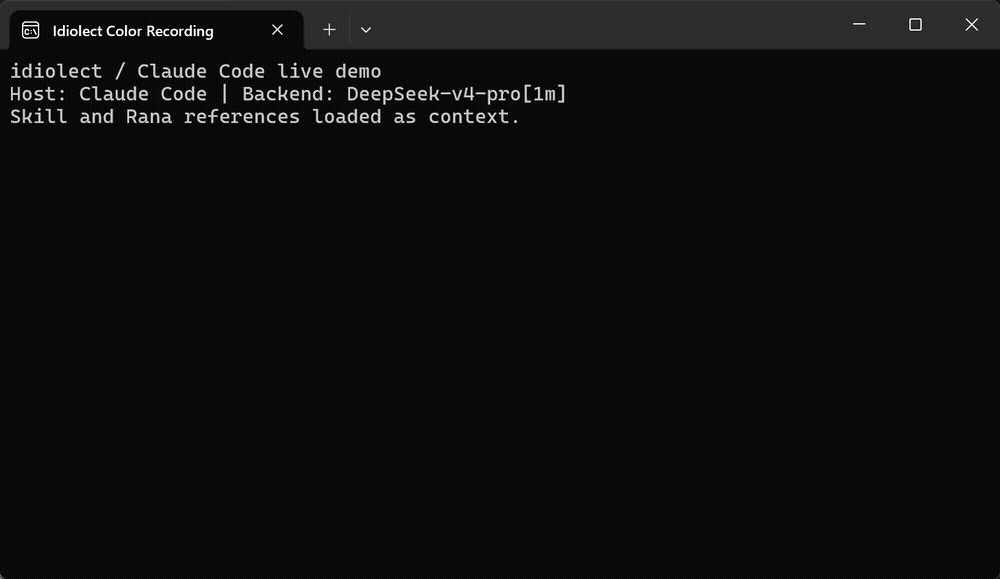
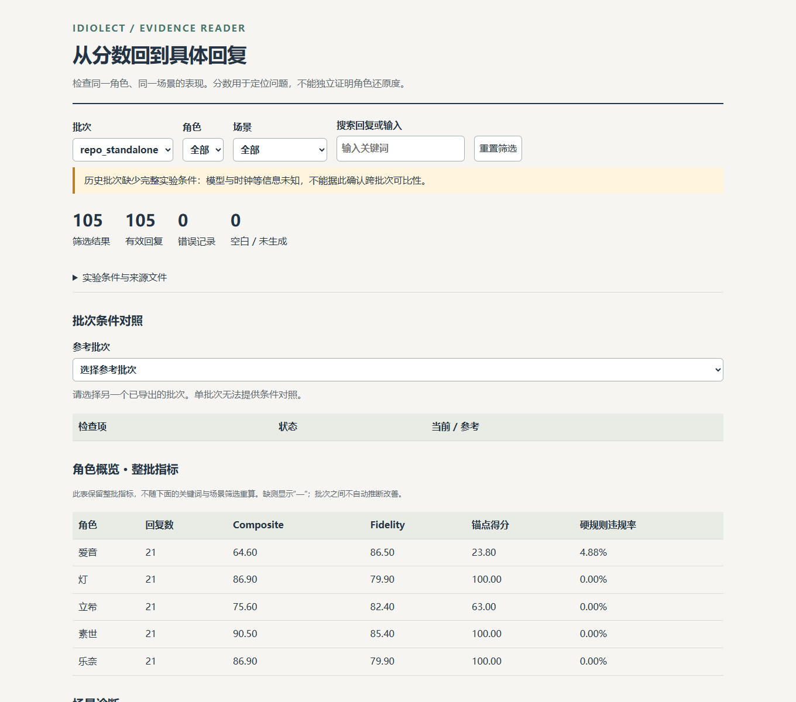

<p align="center">
  <strong>English</strong> · <a href="./README.ja.md">日本語</a> · <a href="./README.md">简体中文</a>
</p>

<p align="center">
  
</p>

<h1 align="center">idiolect</h1>

<p align="center">
  <strong>Make an AI character speak in character, and evaluate the result with reproducible evidence.</strong>
</p>

<p align="center">
  <sub>~~Rikki, why are you holding a guitar — is it because the author was too lazy to re-render the image?~~</sub>
</p>

<p align="center">
  <a href="https://github.com/puresky271/idiolect/actions/workflows/ci.yml"></a>
  <a href="./LICENSE"></a>
  
  
</p>

<p align="center">
  <a href="#-what-you-actually-get">What you get</a> ·
  <a href="#-quick-start">Quick start</a> ·
  <a href="#-four-layers-and-measured-sizes">Four layers</a> ·
  <a href="#-limits-and-caveats">Limits</a> ·
  <a href="#-docs">Docs</a>
</p>

Folks, as vendors keep pushing models harder on coding and agents, AI roleplay is getting harder and harder to keep a straight face through. This repository is one author's write-up of what actually worked: **a methodology for evaluating AI character-dialogue systems, plus a field log of prompt-engineering pitfalls**, with a reusable constraint framework on top. If you are building AI characters, I hope it saves you some of the pain.

If you let a general model play a character, the replies drift into one customer-service voice: they grow longer, "I completely understand how you feel" shows up, every conversation ends on a meaningful note, and then it sits there comforting you indefinitely. This repository works the other way round: it **measures how the character actually talks** from the original script — how long a line is, how many sentences, which verbal tics, what changes by scene — writes those measurements into the prompt as hard constraints, and then runs automated checks on whether the output really got closer. No fine-tuning, and no original script text in the repository — only the statistics.

The running example is the five members of **BanG Dream! It's MyGO!!!!!**. Note that **the method itself is show-agnostic**: it transfers to other works, but the character profiles, corpus baselines and verification scenes all have to be rebuilt. We solve exactly one thing — proving a reply sounds in character — and make it standalone and reproducible.

> [!IMPORTANT]
> **Let us get rights and licensing straight first.**
> **Code** (`idiolect/`, `tools/`, `docs/`, `tests/`) is MIT — use it freely ([`LICENSE`](LICENSE)).
> **The characters and the work are not ours**: MyGO!!!!! characters, settings, story and music belong to **Bushiroad / Craft Egg and the relevant rights holders**. This is an **unofficial fan-made technical project**, not affiliated with, authorised by, or endorsed by them.
> **The repository contains no original script text** (no game script, dialogue or lyrics) and no audio; `data/` holds aggregate statistics only, and the sample illustration is fan usage, not official artwork.
> Details in [`NOTICE.md`](NOTICE.md) and the [Copyright, licence and disclaimer](#-copyright-licence-and-disclaimer) section below.

## 🆕 What v0.1.2 adds

v0.1 answers "**does this character sound like herself?**"; v0.1.2 adds a second, independent grounding axis — "**is the reply constrained by the evidence it can actually see?**" — plus one question spanning both: "**can this evaluation reach a conclusion at all?**" It lands as: the evidence contract `evidence-context/v1` (what the model can see this turn: current / history / unknown, strictly validated), an explicit snapshot adapter, 11 pre-registrable grounding task types, a two-axis report (judged separately, **never one weighted score**), an experiment manifest with a comparability gate, the same-chain mutation self-test, and a unified CLI. The runtime still has **zero third-party dependencies**. Upgrades and migration: [`docs/11-upgrade-guide.md`](docs/11-upgrade-guide.md).

## 📦 What you actually get

| You get | In one line |
|---|---|
| **Assembly library** | `pip install .`, then `from idiolect.assemble import build_messages` returns the four-layer prompt; zero third-party runtime dependencies |
| **An evaluation that proves "closer"** | Probe → (distribution fit / within-cell repetition / verbatim-copy audit) → multi-arm pooling → power estimate; plus two dedicated probes (boundary refusal, multi-turn drift) and a fact-consistency gate. The historical batch below is one real run of 105 replies |
| **An evaluation that checks "is it right"** | Evidence contract + grounding tasks + two-axis gate + experiment registry; 4 built-in suites, synthetic replays and negative controls — all offline once installed |
| **Mechanical gates** | One `offline_smoke.py` run: assembly, scene coverage, trigger matrix, content red lines, data shape, evaluation contract, same-chain self-test, gates, zero-write check |
| **Tooling that transfers** | 69 scripts (acquisition, distillation, probing, scoring, dumps) + ready character data: 26 scenes, 130 character × scene length targets, 114 per-scene tic cells, five style profiles (aggregates only) |
| **Twelve methodology documents** | Corpus, features, evaluation, evidence contract, pitfalls, upgrades — each readable on its own (see [Docs](#-docs)) |

Hand [`skills/mygo-five-roleplay/`](skills/mygo-five-roleplay/SKILL.md) to Claude/Codex and it can roleplay any of the five directly — no API key, no Python. The Skill's static materials share the library's sources but do not execute its dynamic routing, session dedup or post-processing: a good experience does not certify quality.

### Watch the demo, then inspect the evidence

[](assets/readme/roleplay-demo.mp4)

**[Play / download the clip](assets/readme/roleplay-demo.mp4)** · [Static preview](assets/readme/roleplay-poster.png) · [Transcript and provenance](assets/readme/roleplay-transcript.json)

A **25-second** recording of **Claude Code** in Windows Terminal — one real reply from Rana (**DeepSeek-v4-pro[1m]**), only the idle stretches trimmed, not sped up. It does not test automatic Skill discovery or multi-turn stability.



The probe evidence page keeps the missing-condition warnings of historical batches; old batches have no manifest and are never compared automatically. Run `py -X utf8 tools/score/report_html.py --labels <label>` on your own batch; grounding evaluation produces a per-task inspect page via `idiolect eval … --html`.

## 🚀 Quick start

**Pick one of four routes:**

| Route | One command | Notes |
|---|---|---|
| **Let an agent do it** | paste the prompt below into your coding agent | least work: it clones, installs and self-checks |
| **uv (one line, nothing left behind)** | `uvx --from git+https://github.com/puresky271/idiolect idiolect prompt Rana "你今天又想去哪找猫"` | see a prompt immediately; no clone, no environment |
| **pip as a library** | `pip install git+https://github.com/puresky271/idiolect` | as a dependency; zero third-party runtime deps |
| **Files only** | `npx degit puresky271/idiolect idiolect` or `git clone --depth 1 https://github.com/puresky271/idiolect` | for the toolchain or the source |

Prompt for your agent (Claude Code, Codex, anything similar):

> Set up https://github.com/puresky271/idiolect for me: clone it, read `AGENTS.md`, run `python bootstrap.py`, then show me the self-check result, the five characters' complete prompts (`py -X utf8 tools/gates/dump_prompt.py --all --matrix`) and the output of `python -m idiolect selftest`. After that I want to switch to my own characters, following `.claude/skills/idiolect-pipeline/`.

**Then run this from the repository root** (Python 3.11+):

```bash
pip install .                                        # zero third-party runtime dependencies
python -m idiolect list                              # the five built-in characters
python -m idiolect prompt 乐奈 "你今天又想去哪找猫"     # the full system prompt for this message
python -m idiolect showcase "我今天有点撑不住了"        # side-by-side five-character view (no model call)
python -m idiolect chat 乐奈 "你今天又想去哪找猫"       # one real chat turn (env vars below)
python bootstrap.py                                  # set up the toolchain + run the offline_smoke self-check
```

**Evaluation (all offline, zero keys):**

```bash
python -m idiolect capabilities                      # which evaluation capabilities exist, what each covers
python -m idiolect bench list                        # built-in suites and synthetic replays
python -m idiolect eval --suite spatiotemporal-core \
    --responses builtin:spatiotemporal-core.healthy --capabilities spatiotemporal --html
python -m idiolect selftest                          # the evaluation chain's own detection power
```

On Windows, prefer `py -X utf8` over a bare `python`. `chat` and `run --yes` talk to any OpenAI-compatible endpoint: set `LLM_API_KEY` / `LLM_BASE_URL` / `LLM_MODEL` and `pip install "idiolect[llm]"`.

From code:

```python
from idiolect.assemble import build_messages
messages = build_messages("乐奈", "你今天又想去哪找猫")   # ready to send to the model
```

## 🧭 Two evaluation axes and four modes

| | Style axis | grounding axis |
|---|---|---|
| Question it answers | Does it sound like this character? | Is it constrained by the visible evidence? |
| Enabled by default | Yes | No: `--capabilities spatiotemporal` / `long-context-stress` |
| Per-reply checks | Hard length cap (the same number the prompt states), sentence cap, high-severity boundary features, canon facts, thinking-tag leaks | Contract validation → prompt boundary (evidence visible, tense and provenance aligned, hidden values and private metadata isolated) → reply (claims, denials, time qualification, refusals, corrections, citations) |
| When it cannot judge | Scoring module absent from this install → not applicable, with a reason | Open rewording → `needs_review`, awaiting human blind-judgement labels |

Four modes: language only (default, five characters × four messages), spatiotemporal alone, long context alone, or both — combine `--suite language-only / spatiotemporal-core / long-context-smoke` with `--capabilities …`; when a capability is off, its evidence block **does not** enter the prompt. Every built-in replay is a **synthetic reply** used only to validate the chain — a demo is not empirical evidence.

Every verdict carries **applicability, status, reason, numerator/denominator, evidence and scorer version**, and the gate rules are fixed in code: the denominator counts only `pass + fail`; missing measurements, N/A, empty replies and dry-run placeholders never count as passing; any degradation → **FAIL**; only `needs_review` left → **INCONCLUSIVE** (exit code 3); below the pre-registered family minimum, PASS only means "no violation detected"; a model judge is recorded as auxiliary and never changes mechanical verdicts.

## 🧾 Evidence contract: what the model can see this turn

```python
from idiolect.evidence_contract import parse_evidence_context
from idiolect.workspace import build_workspace_messages

context = parse_evidence_context({
    "schema_version": "evidence-context/v1",
    "observer_id": "actor_a", "as_of": "2026-09-12T15:00:00+09:00", "scene_id": "scene_02",
    "current": [{"evidence_id": "evidence_17", "status": "current", "text": "actor_b 在车站东侧入口。"}],
    "history": [{"evidence_id": "evidence_09", "status": "history", "text": "周三排练时 actor_b 在旧练习室。",
                 "as_of": "2026-09-09T18:30:00+09:00"}],
    "unknown": [],
})
messages = build_workspace_messages("乐奈", "她现在在哪？", evidence_context=context)
```

The contract describes only the **model-visible** side; expected answers, hidden values and gold live in the evaluation task's `expect` / `oracle`, and the prompt-boundary check scans the final messages to confirm none of them slipped in. Rendering emits whitelisted metadata only; current / history / unknown are projected upstream — idiolect does not derive world truth from timestamps, and host context can only come in through an [explicit snapshot](docs/09-evidence-grounding.md#3-显式快照-adapter) (`idiolect contract project <snapshot-file>` lists the dropped invisible records). The old unversioned form still works but emits a `DeprecationWarning`: it treats a missing status as current, which the strict contract does not.

## 🔬 The evaluation chain has to be tested too

- **Same-chain mutants**: 25 mutants each change one thing at one injection point and travel **the same** chain as a real evaluation, with the report naming what caught each one; 1 of them is an equivalent variant ("wrap the function, rename a parameter") that must **not** be judged different — detection rests on behaviour, not signatures.
- **Healthy counter-controls**: 9 alternative phrasings of correct answers must stay PASS, keeping false positives in check.
- **A canary in every run**: a known hidden value, a private path and a known violation are planted; the checker must flip its verdict, or the run FAILs outright.
- **Manifest and comparability**: two batches are comparable only if they differ in the pre-registered intervention variable; representation operators are certified one by one — Chinese numeral readings and traditional characters are uncertified and go to `needs_review`.

Catching a mutant only shows that this kind of injected defect can be detected — not a detection rate for natural defects, still less an improvement in model capability.

## 🔍 Numbers of the example cast

| Character | Typical line length (median) | Sentences per turn | Signature habits |
|---|---|---|---|
| Anon | 20 chars | 1.6 | 35% of lines carry an exclamation mark; tics "啊、诶、哦" |
| Tomori | 11 chars | 1.2 | 81% of lines carry ellipses, long runs of "······" |
| Taki | 15 chars | 1.4 | Short and direct; 39% of her original lines open with a bare noun |
| Soyo | 16 chars | 1.4 | Gentle and restrained; exclamation rate only 6% |
| Rana | 6 chars | 1.2 | Extremely short, 3% exclamation rate, topic often hijacked by cats |

Every number in the table can be looked up in [`data/style_profiles.json`](data/style_profiles.json); `tools/score/_noun_initial.py <run-label>` prints Taki's noun-opening rate alongside the original baseline. The gap widens per scene: in a confession scene Rana says 7 characters and Soyo 17 — constraints must be "this character in this situation", never one shared average.

## 📊 Historical probe batch (qualitative example only)

This table is one real probe run, not a design target. A probe sends each character a batch of messages, then collects the replies and scores them item by item:

```bash
py -X utf8 tools/probe/probe_runner.py --label repo_standalone \
    --assemble --turn-logic --registry --cats 通用场景 --runs 3
py -X utf8 tools/score/probe_report.py --label repo_standalone --scenes crisis,comfort --cat 通用场景
```

| Character | Replies | composite (likeness, 100) | fidelity (style fit, control column) | Red-line rate | Leak rate | Scene fit |
|---|---|---|---|---|---|---|
| Anon | 21 | 64.6 | 86.5 | 4.9% | 0% | 0.545 |
| Soyo | 21 | 90.5 | 85.4 | 0.0% | 0% | 0.532 |
| Taki | 21 | 75.6 | 82.4 | 0.0% | 0% | 0.386 |
| Tomori | 21 | 86.9 | 79.9 | 0.0% | 0% | 0.365 |
| Rana | 21 | 86.9 | 79.9 | 0.0% | 0% | 0.504 |

- Conditions: `deepseek-flash`, temperature 0.75, max_tokens 420, clock pinned to daytime, 3 samples per cell, 105 replies in total, zero errors.
- **composite** is the headline metric: 0.65 style fidelity + 0.35 content anchors (see `docs/04-evaluation.md` §2.1). fidelity only measures length and sentence-count distributions and stays a control column — on its own it rewards correct-but-empty assistant tone, and Anon is the live example (top fidelity, bottom composite). When the two disagree, inspect the anchors, the replies and the blind judgments.
- **Scene fit** measures how closely a reply's length and sentence count match the original same-character-same-scene distribution; 1.0 is full agreement, and this batch averages 0.466 over 35 cells. It is a **relative** score for before/after comparison inside one batch — not comparable across models or fixtures.
- 3 replies per cell, 93/105 differ from their cell-mates; verbatim reuse of prompt text is 1% (the copied characters were the verbal tic "诶……", not an example sentence); all four leak categories are 0.
- The raw artifacts are not shipped: re-running the commands reproduces the **process**, and you get your own numbers. This batch predates v0.1.2 and has no manifest, so it can only be browsed and is never compared automatically.

The same inputs with the four layers replaced by an empty system prompt:

| Scene | Empty system | Four layers |
|---|---|---|
| Rana / comforted | "I completely understand how you feel. When pressure surges like a tide..." (380 chars) | "Mm." "Cat. Under the eaves." (median 10) |
| Rana / low mood | "When pressure surges and even breathing feels like effort..." (718 chars) | "Mm. ... A cat over there." |

The **four layers** column is from the `repo_standalone` batch above and is reproducible; the **empty system** column is one manual side-run — a qualitative illustration only.

> [!WARNING]
> This cell is tiny and proves nothing on its own, but it shows one thing: **a probe must assemble its own prompt** — the shipped fixtures have an empty system field, so without `--assemble` you are measuring a bare model with no character prompt at all.

## 🧩 Four layers and measured sizes

Everything measured lands in four layers, in a fixed order — stable parts first (they cache well), per-turn parts last:

| Layer | Plain reading | Content | Frequency | Chars for Rana's cat scene |
|---|---|---|---|---|
| `canon` | Who she is | Long profile | static | 12223 |
| `voice` | How she talks | Sentence patterns, tics, per-person attitude differences, anti-template hard constraints | static | 1940 |
| `style_target` | How much to say this turn | Verifiable numbers for length, sentence count, endings, first person; scene-specific values on a match | per turn | 541 |
| `turn_logic` | What situation this turn is | This turn's scene/topic guidance | per turn (only on match) | 846 |

**All four layers for all five members ship with the repository** — nothing truncated, and you need neither an API key nor a corpus to read them:

```bash
# With the package installed
python -m idiolect prompt Rana "你今天又想去哪找猫"              # the complete system prompt for this message
python -m idiolect prompt 乐奈 "你今天又想去哪找猫" --layers canon,voice   # one layer only

# From a clone: the layered audit copy, the exact messages array, and per-layer sizes
py -X utf8 tools/gates/dump_prompt.py --char 乐奈 --msg "你今天又想去哪找猫"
py -X utf8 tools/gates/dump_prompt.py --all --matrix      # 5 characters x 4 messages = 20 dumps
```

The table below is the measured comfort cell of `--all --matrix`, with the input 我一直在哭，快撑不住了:

| Character | canon | voice | style_target | turn_logic | Total |
|---|---|---|---|---|---|
| Anon | 16285 | 6656 | 533 | 539 | 24013 |
| Tomori | 8068 | 7008 | 530 | 616 | 16222 |
| Taki | 12618 | 5579 | 533 | 491 | 19221 |
| Soyo | 9087 | 2279 | 532 | 479 | 12377 |
| Rana | 12223 | 1940 | 531 | 509 | 15203 |

The text of every layer is readable verbatim: `idiolect/characters/*/` (`canon.py` / `voice.py`), [`data/style_profiles.json`](data/style_profiles.json) and the 130 character × scene cells in `idiolect/scene_length_targets.py`, plus `idiolect/general_scenes.py` and each package's `turn_logic/scenes.py`. Prompt edits must leave before/after evidence: run `dump_prompt.py --phase current` before and after (same input, clock and flags, separate report directories); the workspace path gets the same comparison with `dump_workspace.py`.

**What surrounds the four layers in a real system?** A workspace: a dozen-odd candidate sources are collected, scored, trimmed to a budget, then assembled in a fixed layer order — the four layers sit in the persona slot, the evidence block in `on_demand_evidence`. The skeleton lives in `idiolect/workspace.py` (zero dependencies); see [`docs/08-context-workspace.md`](docs/08-context-workspace.md):

```python
from idiolect.workspace import build_workspace_messages
trace = {}
messages = build_workspace_messages(
    "乐奈", "你今天又想去哪找猫",
    blocks=[("current_state", "乐奈在 RiNG 排练室，下午没课"),
            ("fact_workspace", "用户上周提过想养猫")],
    execution_packet="【本轮执行】回复 ≤19 字",   # appended to this turn's user message
    trace=trace,                                 # optional: layer order, per-layer sizes, layers dropped by budget
)
```

## 🛠️ The toolchain

Quick start used the installed package; this section is the toolchain that ships with the repository (clone first, `py -X utf8 -m pip install -r requirements.txt`).

**One-command health check** (no LLM calls, no repository writes; a good pre-commit gate):

```bash
py -X utf8 tools/offline_smoke.py          # assembly + scenes + red lines + data + contract + self-test + gates + tests + zero-write check
py -X utf8 tools/offline_smoke.py --fast   # skip self-test, gates and tests; results in seconds
```

**Code and comment style** (the two commands the CI lint job runs):

```bash
pip install "idiolect[lint]" && ruff check .   # code correctness and mechanical formatting (pinned version)
py -X utf8 tools/gates/style_gate.py           # Chinese docstrings / comment format / traditional characters / English-only comments
```

**Run a probe** (needs `LLM_API_KEY` / `LLM_BASE_URL` / `LLM_MODEL`):

```bash
py -X utf8 tools/probe/make_fixtures.py                                # generate placeholder fixtures
py -X utf8 tools/probe/probe_runner.py --label dry --dry-run --assemble --registry --runs 1
py -X utf8 tools/probe/probe_runner.py --label run1 --assemble --turn-logic --registry --runs 3 --intervention prompt
py -X utf8 tools/score/probe_report.py --label run1 --scenes crisis,comfort --cat 通用场景
py -X utf8 tools/probe/oob_probe.py --label oob1 --runs 2 --gate       # boundary-refusal probe (fails on a high-severity break)
py -X utf8 tools/probe/multiturn_probe.py --label mt1 --gate           # multi-turn style-drift probe
```

**Real-model grounding batches** (explicitly paid: estimate first, then confirm):

```bash
python -m idiolect run --suite spatiotemporal-core --capabilities spatiotemporal --dry-run   # estimate the call volume only
python -m idiolect run --suite spatiotemporal-core --capabilities spatiotemporal --yes --max-calls 12
python -m idiolect eval --suite spatiotemporal-core --responses <responses-from-previous-step> --capabilities spatiotemporal --html
python -m idiolect compare report/experiments/<experiment-A> report/experiments/<experiment-B>
```

Dry-run placeholders can never pass the formal gate; a response set records the fingerprint of the messages it was generated from, so scoring it after the prompt has changed flags it as stale. Evaluation uses a clock pinned to daytime (`tools/mock_clock.py`); this command only *prints* the environment-variable line:

```bash
py -X utf8 tools/mock_clock.py --set 2026-09-12T03:00:00+09:00
```

**Recompute every number from your own corpus** — you fetch it yourself, see [`docs/02-corpus.md`](docs/02-corpus.md):

```bash
$env:IDIOLECT_CORPUS_DIR = "D:\corpus\mygo-gold"
py -X utf8 tools/distill/export_targets.py
py -X utf8 tools/distill/scene_char_baseline.py
py -X utf8 tools/distill/export_scene_targets.py     # rebuilds the 130 scene length targets
py -X utf8 tools/distill/export_profiles.py          # scoring profiles
py -X utf8 tools/distill/export_profiles.py --check  # verify shipped profiles against the corpus
```

## 🎭 Switching casts

**The method is not tied to one work.** Five skills chain corpus acquisition → distillation → role packages → evaluation (agents load them automatically; humans can read them as a manual):

| Skill | What it does |
|---|---|
| [`idiolect-corpus`](.claude/skills/idiolect-corpus/SKILL.md) | normalise your line collection into the corpus format and split; choose character keys and list every table that must change |
| [`idiolect-distill`](.claude/skills/idiolect-distill/SKILL.md) | derive the five feature classes from the corpus |
| [`idiolect-cast`](.claude/skills/idiolect-cast/SKILL.md) | build the role packages (canon / voice / turn_logic / voice_check) and register them |
| [`idiolect-evaluate`](.claude/skills/idiolect-evaluate/SKILL.md) | run probes, scoring, grounding and the same-chain self-test; leave before/after evidence |
| [`idiolect-pipeline`](.claude/skills/idiolect-pipeline/SKILL.md) | orchestrates the four: hand-off artifacts, per-step gates, what must be written by hand |

Everything the corpus can tell you is automatic (scene system, length targets, profiles, tics, vocabularies); **the canon profile, the voice manifest and the scene copy you write yourself**. The grounding contract and evaluation are cast-agnostic: the opaque `actor_a / scene_02 / evidence_17` and the five characters' names travel the same chain.

## ⚠️ Limits and caveats

> [!CAUTION]
> **No original script text is shipped.** The repository contains aggregate numbers only: length distributions, sentence counts, punctuation rates, tic frequencies, per-scene baselines (130 character-scene cells) and scoring profiles. Example-sentence fields were stripped before publication, and both the health check and the unit tests guard that line. Character and franchise rights belong to Bushiroad, Craft Egg and related rights holders; this project is unaffiliated. See [`NOTICE.md`](NOTICE.md).

> [!NOTE]
> **Scores are relative.** Scene fit, fidelity and composite are only for before/after comparison inside one batch; whether two batches can be compared is decided by the manifest's comparability rules.

**idiolect is not** a world simulator, a memory database or a multimodal acquisition engine: it does not advance world state, retrieve production history or open the host's database or keys; evidence is handed in explicitly by the caller, and images, audio and locations must already be text before they come in.

**Known and unsolved:**

- The cost of zero-example wording: after banning copyable example sentences, length agreement fell from 0.512 to 0.461 (older batch, artifacts not shipped). Accepted on purpose.
- Taki's sentence openings are over-corrected: 39% of her original turns start with a bare noun, this batch pushes that to 62% — the direction overshot.
- Tomori's pause accounting: the reference frame drops silent turns, but her twelve-dot pause is content, not padding — the metric loses either way.
- Fixture measurability: placeholder fixtures have no history, so "what did you mean by that" cells are unreadable.
- grounding's mechanical matching only recognises declared phrasings; any rewording gets `needs_review`. Every built-in replay is synthetic, and **no real-model grounding batch** ships yet.
- The built-in long-context matrix has only 4 families, below the pre-registered minimum: it validates the chain and the measurement, and supports no conclusion about the model in long context.

**The corpus is a snapshot.** New official stories keep appearing, so a re-fetch yields different distributions; every derived statistic records its generating script and can be rebuilt.

## 🗺️ Roadmap

Not yet done (not to be taken as finished): real-model grounding and long-context batches (explicitly paid runner, family minimum reached); a collection interface for human blind-judgement labels and agreement statistics; cross-model, cross-tokenizer long-context comparisons; text adapters for images, audio and location (these belong upstream); certification of the uncertified representation operators. Details and versioning policy: [`docs/11-upgrade-guide.md`](docs/11-upgrade-guide.md).

## 📚 Docs

Not sure where to start? Open [`docs/README.md`](docs/README.md) — reading paths by goal, plus a glossary (the documents themselves are written in Chinese):

[Methodology](docs/00-methodology.md) · [Quickstart](docs/01-quickstart.md) · [Corpus](docs/02-corpus.md) · [Features](docs/03-features.md) · [Style evaluation](docs/04-evaluation.md) · [Tool reference](docs/05-tooling.md) · [Pitfall list](docs/06-lessons.md) · [turn_logic & post-processing](docs/07-turn-logic-and-postprocessing.md) · [Context workspace](docs/08-context-workspace.md) · [Evidence & grounding](docs/09-evidence-grounding.md) · [Long-context stress](docs/10-long-context-stress.md) · [Upgrade guide](docs/11-upgrade-guide.md)

Want to contribute? Pre-submit checks, the prompt-evidence rules, the style gates and the release process are in [`CONTRIBUTING.md`](CONTRIBUTING.md).

## ⚖️ Copyright, licence and disclaimer

`idiolect/`, `tools/`, `docs/`, `tests/` and the rest are released under **MIT** — see [`LICENSE`](LICENSE) (`Copyright (c) 2026 puresky`). Commercial use, modification and redistribution are fine; keep the copyright notice.

The character names, settings, story and music of *BanG Dream! It's MyGO!!!!!* belong to **Bushiroad / Craft Egg and the relevant rights holders**. This repository is an **unofficial fan-made technical project**: not affiliated with the rights holders; the character profiles were compiled by the author from public material and are not official settings; the sample illustration is not official artwork and will be removed on request.

| In | Not in |
|---|---|
| Assembly and evaluation code; acquisition / distillation / scoring scripts; six **aggregate statistics** files under `data/`; synthetic, redacted evaluation tasks and replays; twelve methodology documents | Original game script, dialogue, lyrics, audio or game assets; fine-tuned model weights; sentence-level corpus; real user conversations |

`tools/corpus/` is tooling only and ships no data; you are responsible for checking the source site's terms of service and the law where you live. This repository does not carry a copy of the HuggingFace dataset (`KomeijiForce/BanG_Dream_Events`). The complete statement is in [`NOTICE.md`](NOTICE.md).
