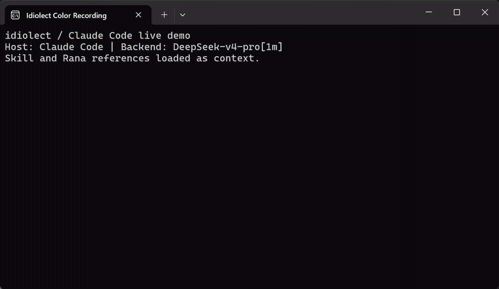
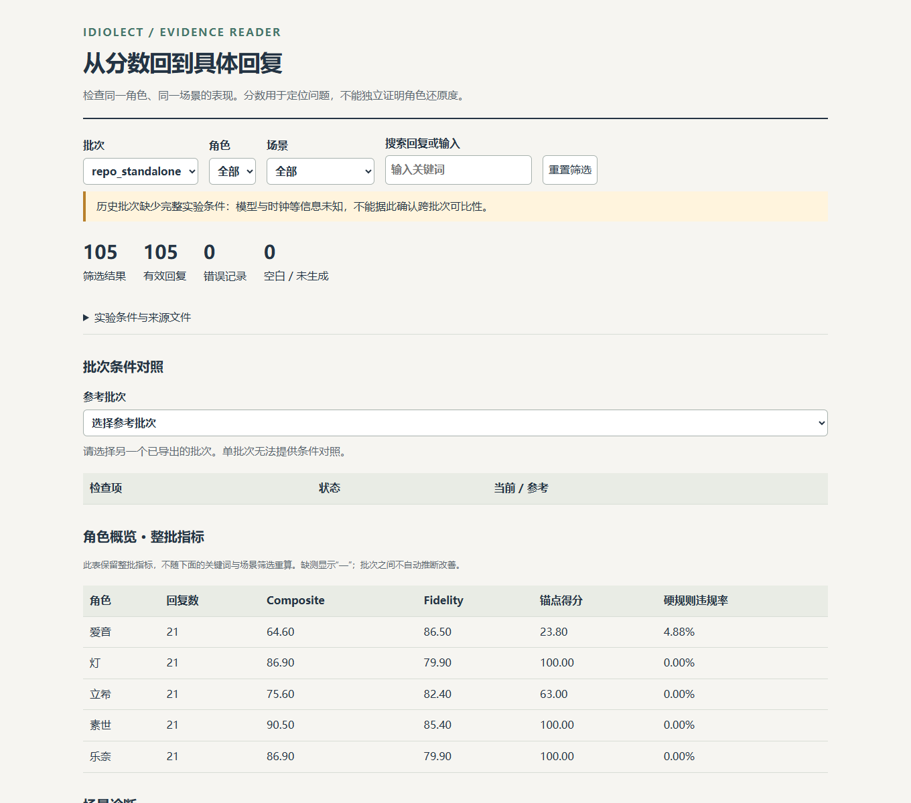
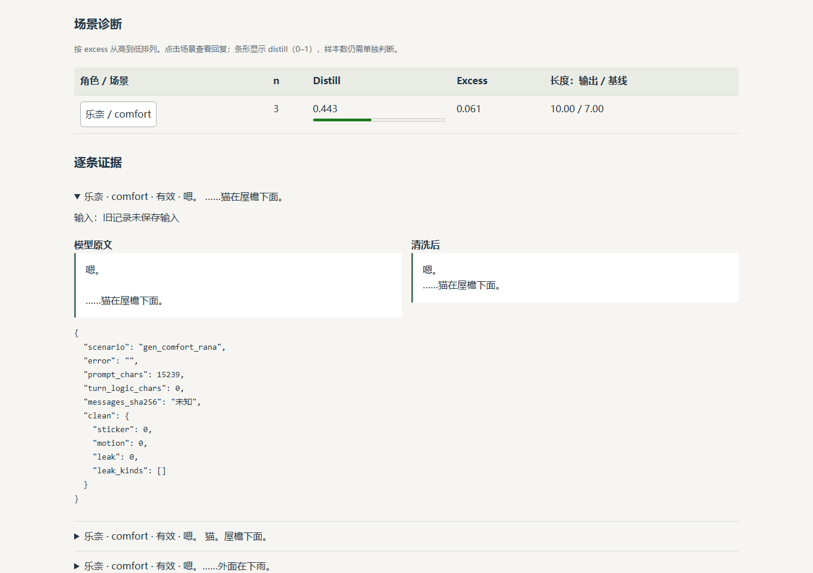

<p align="center">
  <a href="./README.en.md">English</a> · <strong>日本語</strong> · <a href="./README.md">简体中文</a>
</p>

<p align="center">
  
</p>

<h1 align="center">idiolect（個人語型）</h1>

<p align="center">
  <strong>AI にキャラクターらしく喋らせ、再現可能な評価で「前より近づいたか」を確認する。</strong>
</p>

<p align="center">
  <sub>~~Rikki、なんでギターを抱えてるの。作者がもう一枚描き直すのが面倒だったから？~~</sub>
</p>

<p align="center">
  <a href="https://github.com/puresky271/idiolect/actions/workflows/ci.yml"></a>
  <a href="./LICENSE"></a>
  
  
</p>

<p align="center">
  <a href="#-手に入るもの">手に入るもの</a> ·
  <a href="#デモを見て評価の根拠を確かめる">デモと根拠</a> ·
  <a href="#-クイックスタート">クイックスタート</a> ·
  <a href="#-四層アセンブリprompt-はどう組まれるか">四層アセンブリ</a> ·
  <a href="#-ドキュメント">ドキュメント</a>
</p>

どうも。各社がモデルの coding / agent 性能を競い始めてから、AI RP はどんどん気まずくなっています。このリポジトリは、作者が実際に踏んだ道のりからまとめた **「AI キャラクター会話システムの評価方法論 + prompt エンジニアリングの失敗録」** と、その上で動く再利用可能な制約フレームワークです。AI キャラクターを作っている同志の役に立てば幸いです。

汎用モデルにキャラクターを演じさせると、喋っているうちに同じ接客口調へ寄っていきます。文は長くなり、「お気持ちはよく分かります」が出てきて、最後は必ず意味のある締めで終わり、そしてそのまま居座って慰めてくる。このリポジトリがやるのは逆です。まず原作の台詞から**そのキャラクターの喋り方そのものを測ります**——一文の長さ、文数、口癖、場面ごとの違い。その測定値を prompt にハード制約として書き込み、自動チェックで「今回は本当に近づいたか」を検証します。fine-tuning はしませんし、リポジトリに原作の台詞もありません。あるのは統計だけです。

見て分かるようにするため、作例には **BanG Dream! It's MyGO!!!!!** の五人をそのまま使います。ただし**方法そのものは作品に依存しません**。どの作品のキャラクターにも移せますが、その場合はキャラクター資料、コーパスのベースライン、検証用の場面を組み直す必要があります。このリポジトリが解くのは「キャラクターらしく聞こえるか」をどう証明するか、その一点だけです。

> [!IMPORTANT]
> **まず権利とライセンスから。**
> **コード**（`idiolect/`、`tools/`、`docs/`、`tests/`）は MIT です。自由に使ってください（[`LICENSE`](LICENSE)）。
> **キャラクターと作品は本リポジトリのものではありません**：MyGO!!!!! のキャラクター・設定・物語・楽曲の権利は **Bushiroad / Craft Egg および関係権利者**に帰属します。これは**非公式の二次創作技術プロジェクト**で、権利者とは無関係であり、許諾も推奨も受けていません。
> **原作テキスト（脚本・台詞・歌詞）と音声は含みません**。`data/` にあるのは統計された集計値だけです。挿絵も二次創作としての利用で、公式素材ではありません。
> 詳細は [`NOTICE.md`](NOTICE.md) と末尾の[著作権・ライセンス・免責](#-著作権ライセンス免責)へ。

## 🆕 v0.1.2：「それらしく話す」から「見えるものだけを話す」へ

v0.1 が答えるのは一つの問い、**このキャラクターは本人らしく話しているか**です。v0.1.2 はその隣に、互いに独立した第二の問いを加えました：**返答は、モデルに見えている証拠に縛られているか**——今のことはそのまま言い、過去のことには時点を添え、知らないことはでっち上げもせず、むやみに否定もしない。他人の個人的なやり取りや評価用の模範解答は、一文字たりとも prompt に漏らさない。さらに両者にまたがる問いがもう一つ：**この評価そのものから結論を出せるか**。

| 追加 | 一言で |
|---|---|
| **証拠契約** `evidence-context/v1` | バージョン付きの「このターンでモデルに見えるもの」：current / history / unknown の三状態、安定 ID、時刻と場面、出どころ、可視性。フィールドの欠落、宙に浮いた参照、プライベートパス、評価用フィールドはすべて受け付けない |
| **明示的スナップショット adapter** | ホストシステムが**匿名化済みで権限宣言付き**のスナップショットを渡す。adapter はデータベースを開かず、時制を推論せず、観察者に見えないレコードを通さない |
| **grounding 評価** | 事前登録できる 11 種類のタスク：現在の事実、過去の限定、未知、誤った前提、引用、不可視情報の隔離、古い情報を現在と偽るもの、訂正、予算による除外、プライベートメタデータ、純粋なスタイル |
| **二軸レポート** | スタイル軸と grounding 軸を別々に判定・集計し、**重み付けして一つの総合点にはしない**。別枠で回答品質（使用可／空／エラー／打ち切り）と評価の有効性（カバレッジ、N/A の理由、欠測）も示す |
| **オプション機能** | `spatiotemporal`（時空 grounding）と `long-context-stress`（長文脈ストレス）は明示的に有効化する。有効にしなければ、既定の言語ワークフローは**一行も変える必要がない** |
| **実験 manifest + 比較可能性ゲート** | バージョン、内容 SHA、コード revision（dirty を含む）、時計、アセンブリ、scorer、ラベルをすべて登録。事前登録されていない変化があれば、プーリングと「改善」判定はすべて止まる |
| **同一チェーンの変異自己テスト** | 25 個の変異体と 9 個の健全な反対照が、評価と**同じ**チェーンを通る。引数を飲み込むだけの「空洞ゲート」は、実行ごとに組み込まれたカナリアが捕まえる |
| **統一 CLI + オフライン inspect レポート** | `idiolect eval / compare / report / selftest …`、鍵もネットワークも不要。有料の呼び出しには明示的な `--yes` と呼び出し上限が必須 |
| **コードとコメントのスタイルゲート** | CI に lint job を追加：ruff がコードの正しさを、`style_gate.py` が中国語 docstring・コメント書式・繁体字・英語だけのコメントを検査する |

実行時は相変わらず**サードパーティ依存ゼロ**です。上記はすべて `pip install` で wheel に入り、CI はリポジトリの外のクリーンな環境で wheel を `--no-deps` で入れ、もう一度走らせます。アップグレードと移行の説明は [`docs/11-upgrade-guide.md`](docs/11-upgrade-guide.md) にあります。

## 📦 手に入るもの

| 手に入るもの | 具体的に |
|---|---|
| **そのまま使えるアセンブリライブラリ** | `pip install .` のあと `from idiolect.assemble import build_messages` で四層 prompt が返ります。**実行時のサードパーティ依存はゼロ**（openai / numpy / jieba が要るのは probe と蒸留だけ） |
| **「近づいた」を証明する評価ループ** | probe →（分布適合 / 同一セル内の重複 / 逐字コピー監査）→ マルチアームのプーリング → 検出力の見積もり。このほか、境界越えの拒否と多ターンドリフトの二種の専用 probe、さらに事実整合のゲートがあります。下の表は実際に走らせた 105 件の返答です |
| **「正しく話しているか」を確かめる評価** | 証拠契約 + grounding タスク + 二軸ゲート + 実験登録。4 つの組み込み suite（opaque な汎用タスクと、五人に同じ質問を投げるショーケースを含む）、合成リプレイと負の対照付きで、パッケージを入れればオフラインで走ります |
| **七つの機械ゲート + prompt diff ゲート** | prompt の変更を勘で決めないためのものです。`offline_smoke.py` を一回走らせれば、アセンブリ・場面カバレッジ・トリガ行列・内容レッドライン・データ形状・評価契約・同一チェーン自己テスト・ゲート・ゼロ書き込み検査まで通ります |
| **作品を差し替えられるツール群** | 69 本のスクリプト：取得と洗浄、コーパス分割、場面発見、口癖の蒸留、長さ目標の書き出し、probe と採点、prompt と workspace の dump。方法は作品に縛られないので、別のキャストに当てて再実行するだけです |
| **そのまま使えるキャラクターデータ（集計値のみ）** | 26 場面（汎用 13 + キャラ固有 13）、130 個の「キャラ × 場面」長さ目標、114 セルの場面別口癖、五人分のスタイルプロファイル |
| **十二本の方法論ドキュメント** | コーパスの出どころ、五種類の特徴の計算と落とし込み方、評価の仕方、証拠契約と grounding、長文脈ストレス、すでに払った失敗の記録、アップグレードの仕方。どれも単独で読めます |

### Agent 向けの展示用 Skill

[`skills/mygo-five-roleplay/`](skills/mygo-five-roleplay/SKILL.md) のディレクトリーを丸ごと Claude/Codex に渡せば、五人から一人を選んでそのまま会話できます。API key も Python も不要です。キャラクター資料は同梱されていて、選んだときに読み込まれます。必要なキャラクターのサブディレクトリーだけを残しても構いません。「燈と今日の練習の話がしたい」と言えば始まり、「終了」と言えば通常のアシスタントに戻ります。

Skill の静的な資料はライブラリと同じソースから生成されますが、Python 側の動的ルーティング、セッション内の重複排除、後処理は実行しません。体験が良いことは、評価に合格したことを意味しません。評価・蒸留・ゲートが引き続き本筋です。導入、再書き出し、検証は[クイックスタート](docs/01-quickstart.md#先体验五人-skill)を参照してください。

### デモを見て、評価の根拠を確かめる

[](assets/readme/roleplay-demo.mp4)

**[動画を再生 / ダウンロード](assets/readme/roleplay-demo.mp4)** · [静止画](assets/readme/roleplay-poster.png) · [会話原文と出典](assets/readme/roleplay-transcript.json)

**25 秒**の動画は、Windows Terminal 上の **Claude Code** を直接録画したものです。本来の配色を保ち、**DeepSeek-v4-pro[1m]** による楽奈の実際の返答を一往復示します。前後の待機部分だけをカットし、生成過程は加速していません。Skill と楽奈の資料を明示的に読み込み、入力を開始時のメッセージとして渡しました。Skill の自動検出や複数ターンの安定性を検証する動画ではありません。



probe バッチのオフライン評価ページは、過去のバッチに欠けている実験条件の注記をそのまま残します。v0.1.2 からは二つのバッチの**比較可能性**も判定します——古いバッチには manifest のフィールドがないので閲覧専用で、自動で比較されることは決してありません。楽奈の comfort 場面を開けば、モデル原文と整形後の返答を並べて確認できます。



自分のバッチで `py -X utf8 tools/score/report_html.py --labels <label>` を実行すると probe の根拠ページが開けます。grounding 評価のほうは `idiolect eval … --html` でタスクごとの inspect ページを生成します（後述）。画像は過去の `repo_standalone` バッチのもので、上のホスト体験とは別の実験です。

## 🚀 クイックスタート

**まず入手——四つの道から一つを選んでください：**

| 方法 | 一行 | 補足 |
|---|---|---|
| **エージェントに任せる** | 下のプロンプトを coding agent に貼る | 一番楽。clone・依存導入・自己診断まで自分でやります |
| **uv（一行・後始末不要）** | `uvx --from git+https://github.com/puresky271/idiolect idiolect prompt Rana "你今天又想去哪找猫"` | すぐ prompt を見たいとき。clone も環境構築も不要 |
| **pip でライブラリとして** | `pip install git+https://github.com/puresky271/idiolect` | 依存として使う。実行時のサードパーティ依存はゼロ |
| **ファイルだけ** | `npx degit puresky271/idiolect idiolect` または `git clone --depth 1 https://github.com/puresky271/idiolect` | ツール群を動かす／ソースを読む |

エージェントに渡すプロンプト（Claude Code / Codex など）：

> https://github.com/puresky271/idiolect を動く状態にしてください：clone して `AGENTS.md` を読み、`python bootstrap.py` を実行し、自己診断の結果、五人分の完全な prompt（`py -X utf8 tools/gates/dump_prompt.py --all --matrix`）、`python -m idiolect selftest` の出力を見せてください。その後、自分のキャラクターに差し替えたいので `.claude/skills/idiolect-pipeline/` の手順に従ってください。

**入手したら、リポジトリのルートで実行してください**（Python 3.11 以上）：

```bash
pip install .                                        # 実行時依存ゼロ
python -m idiolect list                              # 組み込みキャラの一覧
python -m idiolect prompt 乐奈 "你今天又想去哪找猫"     # この発話での system prompt 全文
python -m idiolect showcase "我今天有点撑不住了"        # 五人を横並びで表示（モデル呼び出しなし）
python -m idiolect chat 乐奈 "你今天又想去哪找猫"       # 実際に一往復（環境変数は下記）
```

コマンド例のキャラクター名 `乐奈` は、日本語表記の `楽奈` でもローマ字の `Rana` でも同じキャラクターとして解決されます。prompt 本文そのものは中国語なので、`prompt` の出力も中国語で出ます。

**評価（すべてオフライン、鍵不要）：**

```bash
python -m idiolect capabilities                      # どんな評価機能があり、それぞれ何をカバーし何をカバーしないか
python -m idiolect bench list                        # 組み込み suite と合成リプレイ
python -m idiolect eval --suite spatiotemporal-core \
    --responses builtin:spatiotemporal-core.healthy --capabilities spatiotemporal --html
python -m idiolect selftest                          # 評価チェーン自身の検出力
```

ツール群まで用意するなら一行で足ります——`.venv` の作成、依存導入、`offline_smoke` の自己診断、一人分の層別字数の表示まで：

```bash
python bootstrap.py
```

Windows では `python` を `py -X utf8` に読み替えてください（素の `python` が依存の入っていないインタプリタを指すことがあります）。`chat` と `run --yes` は任意の OpenAI 互換エンドポイントに投げられます。`LLM_API_KEY` / `LLM_BASE_URL` / `LLM_MODEL` の三つの環境変数を設定し、`pip install "idiolect[llm]"` を入れておいてください。

コードから使う：

```python
from idiolect.assemble import build_messages
messages = build_messages("乐奈", "你今天又想去哪找猫")   # そのままモデルに渡せる messages 配列
```

## 🧭 二つの評価軸：別々に判定し、総合点にはまとめない

| | スタイル軸（style） | grounding 軸 |
|---|---|---|
| 答える問い | このキャラクターらしいか | 見えている証拠に縛られているか |
| 既定で有効 | はい | いいえ：`--capabilities spatiotemporal` / `long-context-stress` |
| 一件ごとの検査 | 字数のハード上限（prompt に書いたのと同じ数）、文数の上限、境界越えの高危特徴、canon の事実、思考タグの漏れ | 契約の検証 → prompt 境界（重要な証拠が見えているか、時制の整合、出どころの整合、隠し値とプライベートメタデータの隔離、層順）→ 返答（主張、否定、時点の限定、拒否、訂正、引用、隠し値） |
| バッチ単位 | probe バッチの分布指標：主要指標、対照列、場面適合、同一セル内の重複、コピー監査（下の過去バッチを参照） | family 単位の合格率 + 対応のある符号検定 |
| 判定できないとき | 採点モジュールが今回のインストールに含まれていない → 該当なしとし、ゲートの説明に列挙 | 自由な言い換え → `needs_review`、人手のブラインド評価ラベル待ち |

判定の一つひとつに**適用可能性、状態、理由、分子／分母、証拠、scorer のバージョン**が付きます。状態は次のものしかありません：`pass`、`fail`、`not_applicable`、`missing`、`needs_review`、`error`、`empty`、`underpowered`。ゲートの基準はコードに固定されています：

- 分母に数えるのは `pass + fail` だけです。欠測、N/A、空の返答、dry-run のプレースホルダは**どれも合格扱いにせず、平均にも入れません**。
- `fail / error / empty / missing` のいずれかがある、機能を有効にしたのに有効な判定がゼロ、すべて N/A → **FAIL**。`needs_review` だけが残る → **INCONCLUSIVE**（終了コード 3）。
- **family が独立の単位です**：同じ family のアーム、ターン、反復、checkpoint はすべて入れ子の観測です。family 数が事前登録の下限を下回るとき、PASS は「違反を検出しなかった」という意味でしかなく、能力についての結論は支えません。
- モデル judge は補助的な記録としてだけ残し（judge と生成モデルの関係を明記）、機械判定は**変えません**。人手のブラインド評価ラベルが書き換えられるのは `needs_review` だけです。

## 🧪 四つのモード：既定はスタイルだけを評価し、機能は明示的に有効化する

| モード | コマンド | 対象のタスク |
|---|---|---|
| 言語のみ（既定） | `idiolect eval --suite language-only --responses builtin:language-only.healthy` | 五人 × 四つの発話。時空 schema は一切不要 |
| 時空のみ | `… --suite spatiotemporal-core --capabilities spatiotemporal` | 証拠契約 + grounding タスク |
| 長文脈のみ | `… --suite long-context-smoke --capabilities long-context-stress` | 長さ × 位置の行列、予算による切り詰めの対照 |
| 両方 | `… --capabilities long-context-stress,spatiotemporal` | 「過去／現在の衝突 × 多ターン」の family を追加 |

二つの機能を必要とするタスクで片方だけを有効にした場合は `not_applicable` と表示され、理由が書かれます。機能を有効にしていなければ、証拠ブロックは prompt に**入りません**。五人に同じ質問を投げるショーケース（`mygo-five-showcase`）は、時制の機能を有効にしてもしなくても走ります：有効なら二軸とも判定し、無効ならスタイルだけを判定します。組み込みのリプレイはすべて**合成された返答**で、評価チェーンの検証にだけ使います——デモは実証ではありません。

## 🧾 証拠契約：このターンでモデルに見えるもの

```python
from idiolect.evidence_contract import parse_evidence_context
from idiolect.workspace import build_workspace_messages

context = parse_evidence_context({
    "schema_version": "evidence-context/v1",
    "observer_id": "actor_a", "as_of": "2026-09-12T15:00:00+09:00", "scene_id": "scene_02",
    "current": [{"evidence_id": "evidence_17", "status": "current", "text": "actor_b 在车站东侧入口。"}],
    "history": [{"evidence_id": "evidence_09", "status": "history", "text": "周三排练时 actor_b 在旧练习室。",
                 "as_of": "2026-09-09T18:30:00+09:00"}],
    "unknown": [],
})
messages = build_workspace_messages("乐奈", "她现在在哪？", evidence_context=context)
```

契約が記述するのは**モデルに見える**側だけです。期待する答え、漏らしてはならない値、gold は評価タスクの `expect` / `oracle` に置き、prompt 境界検査が最終的な messages を走査して、それらが紛れ込んでいないことを確かめます。描画で出力するのはホワイトリストのメタデータだけです：evidence_id、history 項目の時刻、安全な opaque locator、許可された provenance キー。current / history / unknown は上流の投影が与えるもので、idiolect はタイムスタンプから世界の真値を推論しませんし、画像認識、音声・動画のデコード、地理投影も行いません。ホストシステムの文脈は[明示的スナップショット](docs/09-evidence-grounding.md#3-显式快照-adapter)を通してしか入れません：`idiolect contract project <スナップショットファイル>` は、捨てられた不可視のレコードを（ID と理由だけで）列挙します。

旧来のバージョンなしの書き方（`TemporalEvidenceContext.from_dict(バージョンなしの辞書)`）も引き続き使えますが、`DeprecationWarning` が出ます。こちらは欠けた status を current とみなしますが、厳格な契約はそうしません。

## 🔬 評価チェーン自身も検証されなければならない

ゲートが「合格」したのは、入力が上流で捨てられていたから、比較がシグネチャで保証されていたから、あるいは分母が空だったから、というだけかもしれません。そこで：

- **同一チェーンの変異体**：25 個の変異体が、入力契約、adapter、描画、アセンブリ予算、返答、採点器、集計、manifest という注入点でそれぞれ一か所ずつ手を加え、本物の評価と**同じ**チェーンを通ります。レポートは段階ごとに、どこが捕まえたか（構造 / prompt 境界 / 返答 / 集計 / ゲート / 比較）を明記します。そのうち 1 個は「wrapper を一枚かぶせて引数名を変えた」だけの等価体で、差分と判定されては**なりません**——検出は振る舞いで行い、シグネチャには頼りません。
- **健全な反対照**：正常な回答の別の書き方 9 組（三人称での否定、正当な「知らない」、同名だが別の場面、全角数字、五人の短文と省略記号……）は PASS のままでなければならず、これで誤検知を抑えます。
- **実行ごとに組み込まれたカナリア**：境界検査には既知の隠し値とプライベートパスを一つずつ、返答検査には既知の違反を一つ仕込みます——検査器が判定を反転させなければ、その実行はそのまま FAIL です。隠し引数を受け取りながら捨てるゲートは、ここで正体を現します。
- **表現演算子を一つずつ認証**：全角数字、桁区切りのカンマ、大文字小文字、空白、省略記号、日本語の文脈といった無害な変換は判定を保たなければなりません。中国語の数字の読み方と繁体字は**未認証**で、出てきたら `needs_review` に回します。
- **manifest と比較可能性**：二つのバッチが比較できるのは、事前登録した介入変数だけが違う場合に限ります。モデル、時計、scorer、ラベル、suite に介入以外の変化があれば、自動プーリングと「改善」判定はすべて止まります。フィールドが欠けていれば `incomparable`、登録ディレクトリ内の産物が改変されていれば fail closed です。

変異体が捕まったことが示すのは「この種の注入された欠陥をこのチェーンで検出できる」ということだけです。自然な欠陥の検出率ではなく、ましてやモデル能力の向上でもありません。

## 🔍 作例キャストのサンプル分析

MyGO!!!!! の五人を例に：

| キャラ | 一文の長さ（中央値） | 平均文数 | 目立つ癖 |
|---|---|---|---|
| 愛音 | 20 字 | 1.6 文 | 35% の文に感嘆符。口癖は「啊、诶、哦」 |
| 燈 | 11 字 | 1.2 文 | 81% の文に省略記号。`······` が連なる |
| 立希 | 15 字 | 1.4 文 | 短く直截。原作では 39% が名詞で言い切る |
| そよ | 16 字 | 1.4 文 | 柔らかく抑制的。感嘆率は 6% だけ |
| 楽奈 | 6 字 | 1.2 文 | 極端に短い。感嘆率 3%、話題はよく猫に持っていかれる |

中央値・文数・感嘆符と省略記号の比率は [`data/style_profiles.json`](data/style_profiles.json) で一件ずつ確認できます。立希の行の「名詞で言い切る」はコーパス側の集計で、`tools/score/_noun_initial.py <ラベル>` が原作ベースラインと並べて表示します。

同じ場面ではさらに差が開きます。たとえば「告白された」場面で楽奈は 7 字、そよは同じ場面で 17 字。だから制約は「このキャラ × この場面」でなければならず、「全員共通の平均」ではいけません。

## ❓ なぜ必要か

モデルにキャラクターを演じさせると、安定して四つの癖が出ます。モデルが失敗しているわけではなく、訓練目標の素直な産物です。

1. **返答が長くなる**：原作で 7 字の場面を、モデルは 700 字書けます。
2. **共感テンプレート**：「お気持ちはよく分かります。プレッシャーが波のように押し寄せて……」
3. **締めの昇華**：どの会話も、意味のある立派な結びで終わらせたがります。
4. **設定を漏らす**：自分の設定について語り出し、内心の独白や思考タグをそのまま出します。

キャラクターを記憶・予定・世界状態を持つシステムに繋いだとたん、別の癖も出てきます：先週の居場所を今のことのように話す、相手の個人的なやり取りを口にしてしまう、知らないことに答えをでっち上げる、「写真を見たんだから」と聞かれるとそのまま写真を描写してしまう。どれも「らしさ」とは無関係で、スタイルの点数がいくら高くても防げません——だから v0.1.2 はこれらを第二の軸に移して別に判定します。

五人が同じ慰めを返すなら、キャラクターに違いはありません。だからこの方法の核心は一行です：**「似ているか」も「正しいか」も測定できるものに変えて、その数字に向かって直す**。

- **比べるのは「同じキャラ × 同じ場面」の原作台詞だけ**。「人は普通こう話す」とも、「そのキャラの全体平均」とも比べません。
- **数字は容疑者を挙げるだけで、判決は下しません**。燈の出力が参照の 5 倍長いのは、半分は省略記号も字数に数えているせいです。問題かどうかは返答を読んで判断します。
- **サンプルが足りなければ「結論なし」と言う**。各セル 6 件だと、同じ場面・同じ prompt でも楽奈の適合スコアは 0.551 から 0.350 まで振れます。測りたい効果より大きい揺れです。
- **キャラクターが見るテキストに「コーパス」「中央値」「ベースライン」を出さない**。見えたモデルは、自分の設定の話に引きずられることがあります。
- **評価用の答えは決して prompt に入れない**。判定できないものは判定できないと書きます：空白は正しい拒否ではなく、未知は否定ではありません。

方法の全体は [`docs/00-methodology.md`](docs/00-methodology.md) にあります。

## 📊 過去の probe バッチ（定性的な例のみ）

下の表は実際の probe（探針）の結果で、設計目標ではありません。probe とは、五人のキャラクターに同じ一批の発話を送り、返答を回収して項目ごとに採点する一連の流れです：

```bash
py -X utf8 tools/probe/probe_runner.py --label repo_standalone \
    --assemble --turn-logic --registry --cats 通用场景 --runs 3
py -X utf8 tools/score/probe_report.py --label repo_standalone --scenes crisis,comfort --cat 通用场景
```

| キャラ | 返答数 | composite（似ているか、100 点満点） | fidelity（スタイル適合、対照列） | レッドライン率 | 設定漏れ率 | 場面適合スコア |
|---|---|---|---|---|---|---|
| 愛音 | 21 | 64.6 | 86.5 | 4.9% | 0% | 0.545 |
| そよ | 21 | 90.5 | 85.4 | 0.0% | 0% | 0.532 |
| 立希 | 21 | 75.6 | 82.4 | 0.0% | 0% | 0.386 |
| 燈 | 21 | 86.9 | 79.9 | 0.0% | 0% | 0.365 |
| 楽奈 | 21 | 86.9 | 79.9 | 0.0% | 0% | 0.504 |

- 生成条件：`deepseek-flash`、temperature 0.75、max_tokens 420、時計は昼に固定、各セル 3 件で合計 105 件、エラーなし。
- **composite** が主要指標です：スタイル忠実度 0.65 + 内容アンカー 0.35（定義は `docs/04-evaluation.md` 第 2.1 節）。fidelity は長さと文数の分布だけを測る対照列で、単独では「正しいが中身のないアシスタント口調」に水増しされます。愛音が実例です：fidelity は首位、composite は最下位（文体は整っているが、具体的な事柄が少ない）。二つが乖離したら、アンカー、実際の返答、ブラインド評価を確認してください。composite もアンカー得点が上限に達すると差を捉えにくくなります。
- **場面適合スコア**は、返答の長さと文数が「同じキャラ・同じ場面の原作分布」にどれだけ合うかを示す値です。1.0 で完全一致、このバッチの平均は 0.466（35 セル）。**相対量**なので、同じバッチ内での before/after 比較にだけ使ってください。モデルや fixture を変えれば、バッチを跨いだ比較はできません。
- 同じセルの 3 件が互いに重ならない割合は 93/105。prompt 内のテキストを逐字で書き写した割合は 1% で、写された 3 字は口癖の「诶……」であり、例文ではありません。
- 「設定漏れ」は思考タグ・内心の独白・話者エコー・中国語の動作ナレーションの四種類を数えており、このバッチはすべて 0 です。
- この表の生の産物（`report/probe_*.jsonl` と採点レポート）は、産物の規律に従ってリポジトリに含めていません。上のコマンドを再実行して再現できるのは**手順**で、得られるのは自分のバッチの数字です。このバッチは v0.1.2 より前に走らせたもので manifest がないため、閲覧専用であり、新しいバッチと自動で比較されることはありません。

同じ入力で、四層 prompt を空の system に差し替えるとどうなるか：

| 場面 | 空の system | 四層アセンブリ |
|---|---|---|
| 楽奈 / 慰められる | 「お気持ちはよく分かります。プレッシャーが波のように押し寄せて……」（380 字） | 「嗯。」「猫。屋檐下面。」（中央値 10 字） |
| 楽奈 / 気分が沈む | 「プレッシャーが波のように押し寄せ、呼吸さえ億劫になるとき……」（718 字） | 「嗯。……那边有猫。」 |

二列の出どころは違います。**四層の列**は上の `repo_standalone` バッチのもので、自分で再現できます。**空 system の列**は当時手で回した一度きりの対照——あの一般的な助手口調の返答そのままの記録——で、probe の成果物はリポジトリに含めていません。定性的な例としてだけ読んでください。

> [!WARNING]
> このセルはサンプルが小さく、証拠にはなりません。ただし一つだけ分かります：**probe は自分で prompt を組まなければならない**。同梱の fixture は system が空なので、`--assemble` を付けないと「キャラクター prompt の無い裸のモデル」を測ってしまいます。

## 🧩 四層アセンブリ：prompt はどう組まれるか

測ったものは四層に落ちます。順序は固定で、安定した部分を前に（キャッシュが効く）、毎ターン変わる部分を後ろに置きます：

| 層 | 平たく言うと | 中身 | 変化の頻度 | 楽奈の猫場面での字数 |
|---|---|---|---|---|
| `canon` | この人は誰か | 長いプロフィール | 静的 | 12223 |
| `voice` | この人はどう喋るか | 文型、口癖、相手ごとの態度差、「テンプレ腔を書くな」というハード制約 | 静的 | 1940 |
| `style_target` | このターンでどれだけ話すか | 字数・文数・文末・一人称の具体的な数字。場面が当たればその場面の数字に差し替え | 毎ターン | 541 |
| `turn_logic` | このターンはどんな場面か | そのターンの場面／話題の指針 | 毎ターン（当たったときだけ注入） | 846 |

この四層が、「測った特徴をどう prompt に入れるか」に対するこのリポジトリの答えの全部です。実際のシステムでは、この前に記憶・世界状態・スケジュールを繋げられます。それらの層はこの方法とは無関係です。

組み上がりは `tools/gates/dump_prompt.py` で層ごとに出力して確認できます。変更の前後ではどちらも `--phase current` を使い、入力・時計・スイッチを揃えて、それぞれ別のレポートディレクトリーに保存してください。四層以外の workspace の経路（外部ブロック、履歴、実行パケット、予算による末尾の刈り込み、証拠ブロック）は、`tools/gates/dump_workspace.py` で同じように前後を比較します。

**実際のシステムで、四層の前後には何があるのか。** モデルは毎ターン「今何時か、キャラはどこにいるか、さっき何の話をしていたか、ユーザーが先週何を言ったか」も知る必要があります。その文脈は**ワークスペース方式**で組みます——十数路の候補材料をまず全部集め、採点・並べ替え・予算での刈り込みを行い、固定の層順でアセンブルする。四層はその中の persona スロットに、証拠ブロックは `on_demand_evidence` スロットに入ります。骨組みは `idiolect/workspace.py`（依存ゼロ）にあり、詳細は [`docs/08-context-workspace.md`](docs/08-context-workspace.md)：

```python
from idiolect.workspace import build_workspace_messages
trace = {}
messages = build_workspace_messages(
    "乐奈", "你今天又想去哪找猫",
    blocks=[("current_state", "乐奈在 RiNG 排练室，下午没课"),
            ("fact_workspace", "用户上周提过想养猫")],
    execution_packet="【本轮执行】回复 ≤19 字",   # このターンの user の末尾に付く
    trace=trace,                                 # 任意：層順、層ごとの字数、予算で外された層を書き込む
)
```

## 📖 五人分の prompt は全文そのまま読めます

「方法だけ置いておくので、キャラクターは自分で設定してください」ではありません。**五人の四層 prompt はすべてリポジトリに同梱**されています：canon の長いプロファイル、voice manifest、話す尺度、場面の指針。省略も切り詰めもなく、鍵もコーパスも無しで読めます。

```bash
# パッケージを入れてあれば（clone 不要・鍵不要・コーパス不要）
python -m idiolect prompt Rana "你今天又想去哪找猫"              # この発話での system prompt 全文
python -m idiolect prompt 乐奈 "你今天又想去哪找猫" --layers canon,voice   # 層を指定して見る

# clone してあれば、層別の監査版・モデルに渡す messages 配列・層別字数も取れます
py -X utf8 tools/gates/dump_prompt.py --char 乐奈 --msg "你今天又想去哪找猫"
py -X utf8 tools/gates/dump_prompt.py --all --matrix      # 5 キャラ × 4 発話 = 20 本
```

産物は三点：`prompt_<キャラ>_<phase>_<label>.txt`（人が読む層別版）、`.json`（そのままモデルに渡す messages）、`.layers.json`（層別字数）。下の表は `--all --matrix` の comfort セルの実測値です（入力「我一直在哭，快撑不住了」）：

| キャラ | canon | voice | style_target | turn_logic | 四層合計 |
|---|---|---|---|---|---|
| 愛音 | 16285 | 6656 | 533 | 539 | 24013 |
| 燈 | 8068 | 7008 | 530 | 616 | 16222 |
| 立希 | 12618 | 5579 | 533 | 491 | 19221 |
| そよ | 9087 | 2279 | 532 | 479 | 12377 |
| 楽奈 | 12223 | 1940 | 531 | 509 | 15203 |

四層の本文はどれもリポジトリ内で一字ずつ読めます：`canon` と `voice` は `idiolect/characters/*/`（`canon.py` / `voice.py`）、話す尺度の数字は [`data/style_profiles.json`](data/style_profiles.json) と `idiolect/scene_length_targets.py` の 130 個の「キャラ × 場面」セル、場面の指針は `idiolect/general_scenes.py` と各パッケージの `turn_logic/scenes.py` にあります。

## 🛠️ ツール一式を走らせる

上のクイックスタートはインストール済みのパッケージを使いました。この節はリポジトリ同梱のツール群です（クローンが必要）：

```bash
py -X utf8 -m pip install -r requirements.txt
```

**一行で健康診断**（LLM を呼ばず、リポジトリにも書かない。コミット前の検査に向く）：

```bash
py -X utf8 tools/offline_smoke.py          # アセンブリ + 場面 + レッドライン + データ + 評価契約 + 同一チェーン自己テスト + ゲート + 単体テスト + ゼロ書き込み検査
py -X utf8 tools/offline_smoke.py --fast   # 自己テスト・ゲート・単体テストを飛ばして数秒で結果
```

**コードとコメントのスタイル**（CI の lint job が走らせるのはこの二つです）：

```bash
pip install "idiolect[lint]" && ruff check .   # コードの正しさと機械的な書式（バージョン固定）
py -X utf8 tools/gates/style_gate.py           # 中国語 docstring / コメント書式 / 繁体字 / 英語だけのコメント
```

**probe を回す**（`LLM_API_KEY` / `LLM_BASE_URL` / `LLM_MODEL` が必要）：

```bash
py -X utf8 tools/probe/make_fixtures.py                                # プレースホルダ fixture を生成
py -X utf8 tools/probe/probe_runner.py --label dry --dry-run --assemble --registry --runs 1
py -X utf8 tools/probe/probe_runner.py --label run1 --assemble --turn-logic --registry --runs 3 --intervention prompt
py -X utf8 tools/score/probe_report.py --label run1 --scenes crisis,comfort --cat 通用场景
py -X utf8 tools/probe/oob_probe.py --label oob1 --runs 2 --gate       # 境界越え拒否の probe（高危で破綻したら FAIL）
py -X utf8 tools/probe/multiturn_probe.py --label mt1 --gate           # 多ターンドリフトの probe
```

**grounding 評価の実モデルバッチ**（明示的な有料実行：まず見積もりを見てから確定する）：

```bash
python -m idiolect run --suite spatiotemporal-core --capabilities spatiotemporal --dry-run   # 呼び出し量を見積もるだけ。プレースホルダを書く
python -m idiolect run --suite spatiotemporal-core --capabilities spatiotemporal --yes --max-calls 12
python -m idiolect eval --suite spatiotemporal-core --responses <上一步写出的回复集> --capabilities spatiotemporal --html
python -m idiolect compare report/experiments/<实验A> report/experiments/<实验B>
```

dry-run のプレースホルダが正式なゲートを通ることは決してありません。返答セットには生成時の messages のフィンガープリントが記録されているので、prompt を変えたあとで採点すると期限切れの産物と判定されます。

**評価用の時計**：キャラクターは時間帯に敏感なので、評価は昼に固定した偽時計（`tools/mock_clock.py`。パッケージ内の評価も同じ `IDIOLECT_MOCK_NOW` を読みます）で統一します。下のコマンドは設定すべき環境変数を**表示するだけ**で、shell に貼って初めて効きます：

```bash
py -X utf8 tools/mock_clock.py --set 2026-09-12T03:00:00+09:00
```

**自分のコーパスで全部の数字を計算し直す**（コーパスは自分で取得。[`docs/02-corpus.md`](docs/02-corpus.md) 参照）：

```bash
$env:IDIOLECT_CORPUS_DIR = "D:\corpus\mygo-gold"
py -X utf8 tools/distill/export_targets.py
py -X utf8 tools/distill/scene_char_baseline.py
py -X utf8 tools/distill/export_scene_targets.py     # idiolect/scene_length_targets.py の 130 目標を再構築
py -X utf8 tools/distill/export_profiles.py          # 採点に使うプロファイル
py -X utf8 tools/distill/export_profiles.py --check  # 公開済みプロファイルとコーパスの一致を検証
```

## 🎭 別のキャスト：skill で全工程を繋ぐ

上の数字はこの五人分です。**方法そのものは作品に縛られません**——自分のキャラクターで回したいときのために、「コーパス入手 → 蒸留 → キャラクターパッケージ → 評価」を繋ぐ五つの skill を同梱しています。Claude Code 系の skill を解釈できるエージェントは自動で読み込みますし、人間が操作マニュアルとして読んでも構いません：

| skill | やること | 産物 |
|---|---|---|
| [`.claude/skills/idiolect-corpus`](.claude/skills/idiolect-corpus/SKILL.md) | 手持ちの台詞集を規定のコーパス形式と分割に整える。キャラ key を決め、**一緒に直す必要のある表を全部**列挙 | `raw/gold/{lang}.jsonl` + `gold_stats.json` |
| [`.claude/skills/idiolect-distill`](.claude/skills/idiolect-distill/SKILL.md) | コーパスから五種類の特徴の派生統計を算出 | `data/` の六つの JSON + `idiolect/scene_length_targets.py` |
| [`.claude/skills/idiolect-cast`](.claude/skills/idiolect-cast/SKILL.md) | キャラクターパッケージ（canon / voice / turn_logic / voice_check）を作り四層に登録 | `idiolect/characters/<key>/` |
| [`.claude/skills/idiolect-evaluate`](.claude/skills/idiolect-evaluate/SKILL.md) | probe と四段階の採点、grounding 評価と同一チェーン自己テストを回し、before/after の証拠を残す | `report/probe_*.jsonl`、`report/experiments/` |
| [`.claude/skills/idiolect-pipeline`](.claude/skills/idiolect-pipeline/SKILL.md) | 上の四つを編成：受け渡し物、各段のゲート、人が書くべき部分 | 再現可能な一連の流れ |

一行で言うと：**コーパスから計算できるものは自動**（場面体系、長さ目標、スタイルプロファイル、口癖、語彙）、**canon の長いプロファイル・voice manifest・場面本文は自分で書く**。汎用の grounding 契約と評価はキャラクターに縛られません：opaque な `actor_a / scene_02 / evidence_17` も五人の名前も、同じチェーンを通ります。

## ⚠️ 境界と注意点

> [!CAUTION]
> **原作テキストは配布しません。** リポジトリにあるのは集計値だけです：字数分布、文数、句読点の出現率、口癖の頻度、場面ベースライン（130 個の「キャラ × 場面」）、採点用プロファイル。公開前にベースラインファイルの例文フィールドは剥がしてあり、健康診断スクリプトと単体テストがそれぞれ一本、この線を見張っています。キャラクターと作品の権利は Bushiroad / Craft Egg および関係権利者に帰属し、本プロジェクトは権利者と関係ありません。[`NOTICE.md`](NOTICE.md) を参照。

> [!NOTE]
> **スコアは相対量です。** 適合スコアも fidelity も composite も、同じバッチ内での before/after 比較に使うものです。バッチ同士を比べられるかどうかは manifest の比較可能性ルールが決めることで、「見た目が大体同じ」かどうかで決めるものではありません。

**idiolect ではないもの**：世界シミュレータでも、記憶データベースでも、マルチモーダルな取得・融合エンジンでもありません。世界状態を進めず、本番の履歴を検索せず、ホストのデータベースや鍵を開きません。証拠は呼び出し側が明示的に渡すもので、モダリティのフィールドは出どころを示すだけです。画像・音声・位置は、入ってくる前にテキストになっていなければなりません。

**まだ解決していないこと：**

- ゼロショット化の代償：例文を禁止したあと、長さの適合度が 0.512 から 0.461 へ落ちました（二つの数は古いバッチのもので、成果物はリポジトリに含まれていません）。この代償は承知の上です。
- 立希の文頭が矯正しすぎ：原作では 39% のターンが名詞で始まるのに、このバッチの probe では 62% まで上がっています（`tools/score/_noun_initial.py <ラベル>` が原作ベースラインと並べて表示します）。方向が逆です。
- 燈のポーズの計上：参照系は沈黙のターンを除外しますが、彼女の十二点リーダーは内容であって余剰ではありません。どちらに転んでも損になります。
- probe fixture の測定可能性：「さっきのあれ、どういう意味」は指せる前文が要りますが、プレースホルダ fixture には前文が無く、この種の場面のスコアは読めません。
- 立希と燈の場面適合スコアは今も五人の中で最低の二つです（0.386 / 0.365）。
- grounding の機械的な照合が認めるのは、タスクで宣言された書き方だけです：任意の言い換えは `needs_review` になり、中国語の数字の読み方と繁体字は未認証です。組み込みのリプレイはすべて合成で、**実モデルの grounding バッチはまだ一つも**リポジトリに含まれていません。
- 長文脈の組み込み行列には family が 4 つしかなく、事前登録の下限を大きく下回ります：検証しているのはチェーンと計量であって、「長文脈でモデルが良くなった／悪くなった」という結論は一切支えません。token 数は既定で unknown です。

**コーパスはスナップショットです。** 公式は新しいストーリーを追加し続けるので、取り直した分布は元のバッチと違ってきます。派生統計はすべて生成スクリプトが分かる形になっているので、再計算できます。

## 🗺️ ロードマップ

このバージョンで実装済みでテストのあるものは上に書いたとおりです。**まだやっていない**部分（このバージョンの範囲外で、完了したものとして扱うべきでもないもの）：

- 実モデルの grounding と長文脈のバッチ：明示的な有料 runner を用意し、事前登録の family 数が下限に達してから走らせる。
- 人手のブラインド評価ラベルの収集画面と、アノテーション一致度の統計（今は `labels/v1` の統合と帰属だけ）。
- モデルや tokenizer を跨いだ長文脈の比較（今の token 計数は任意のプラグイン）。
- 画像・音声・位置などのモダリティをテキスト化する adapter（上流の領分で、idiolect はテキスト化された証拠を消費するだけ）。
- 未認証の表現演算子（中国語の数字、繁体／簡体）の認証と拡張。

詳細とバージョン方針は [`docs/11-upgrade-guide.md`](docs/11-upgrade-guide.md) にあります。

## 📚 ドキュメント

どれから読むか迷ったら [`docs/README.md`](docs/README.md) へ。「何をしたいか」で幾つかの道に分け、用語表も置いてあります。方法論ドキュメントは**中国語**で書かれていますが、各ファイルは独立して読めます。

| ドキュメント | 内容 |
|---|---|
| [`docs/00-methodology.md`](docs/00-methodology.md) | 方法の総論：ループ、不変条件、証拠の階級、既知の残り |
| [`docs/01-quickstart.md`](docs/01-quickstart.md) | インストールと五分で分かるまで |
| [`docs/02-corpus.md`](docs/02-corpus.md) | コーパスの取得・洗浄・派生統計の一覧 |
| [`docs/03-features.md`](docs/03-features.md) | 五種類の特徴の算出・落とし込み・トリガ語の規律 |
| [`docs/04-evaluation.md`](docs/04-evaluation.md) | スタイル軸：三種の指標、プーリング、ゲート、境界越え拒否と多ターンドリフト、事実整合、よくある誤読 |
| [`docs/05-tooling.md`](docs/05-tooling.md) | ツールマニュアル（統一 CLI、prompt / workspace dump、スタイルゲートを含む） |
| [`docs/06-lessons.md`](docs/06-lessons.md) | 失敗録：どの制約が何に教えられたか |
| [`docs/07-turn-logic-and-postprocessing.md`](docs/07-turn-logic-and-postprocessing.md) | turn_logic モジュールと voice_check 後処理 |
| [`docs/08-context-workspace.md`](docs/08-context-workspace.md) | コンテキストワークスペース：実システムで四層と証拠ブロックの前後にあるもの |
| [`docs/09-evidence-grounding.md`](docs/09-evidence-grounding.md) | 証拠契約、スナップショット adapter、grounding タスク、二軸、manifest と同一チェーン自己テスト |
| [`docs/10-long-context-stress.md`](docs/10-long-context-stress.md) | オプション機能：長文脈ストレスの事前登録設計、生成器と計量 |
| [`docs/11-upgrade-guide.md`](docs/11-upgrade-guide.md) | アップグレードと移行、バージョン方針、プラグイン開発の規約、評価の境界、ロードマップ |

コントリビュートしたい方へ：提出前のチェック、prompt 変更時の証拠ルール、スタイルゲート、リリース手順は [`CONTRIBUTING.md`](CONTRIBUTING.md) にあります。

## ⚖️ 著作権・ライセンス・免責

### コード：MIT

`idiolect/`、`tools/`、`docs/`、`tests/`、`conftest.py`、`pyproject.toml` は **MIT** で公開します。[`LICENSE`](LICENSE)（`Copyright (c) 2026 puresky`）を参照。商用利用・改変・再配布はいずれも可で、著作権表示を残してください。

### キャラクターと作品：本リポジトリのものではない

『BanG Dream! It's MyGO!!!!!』のキャラクター名・設定・世界観・物語・楽曲の権利は **Bushiroad / Craft Egg および関係権利者**に帰属します。本リポジトリは**非公式の二次創作技術プロジェクト**です：

- 権利者とは**一切関係がなく**、許諾・スポンサード・推奨を受けていません。
- キャラクターの長いプロファイル（`idiolect/characters/*/canon.py`）は、本リポジトリの作者が**公開情報から整理**したもので、技術研究のためのものです。公式設定ではありません。
- 挿絵（[`assets/readme/hero.png`](assets/readme/hero.png)）は**公式素材ではありません**。二次創作としての利用で、キャラクターの権利は権利者に残ります。権利者から要請があれば直ちに削除します。

### 何が入っていて、何が入っていないか

| 入っている | 入っていない |
|---|---|
| アセンブリと後処理のコード；評価契約・grounding・長文脈評価のコード；取得／蒸留／採点のスクリプト；`data/` の六つの**集計統計**ファイル；合成・匿名化済みの評価タスクとリプレイ；十二本の方法論ドキュメント | 原作の脚本・台詞・歌詞・音声・ゲーム素材；fine-tuning したモデル重み；文単位のコーパス；実ユーザーの会話や本番の状態 |

`data/` で最も長い文字列は 56 字の説明フィールドです。`scene_char_baseline.json` と `scene_stats.json` の例文フィールドは公開前に `--no-exemplars` で剥がしてあります。この線を見張る検査が二本あります：`tests/test_tooling_contracts.py::test_shipped_profiles_have_no_text` と、`offline_smoke.py` の「数据.无原作文本」項目です。

### 自分でコーパスを取得する場合

`tools/corpus/` は取得と洗浄のツールだけで、**データは含みません**。取得元サイトの利用規約とお住まいの地域の法令は、利用者自身で確認し、責任を負ってください。本リポジトリは HuggingFace データセット（`KomeijiForce/BanG_Dream_Events`）の複製を同梱せず、統一形式に整えるスクリプトだけを持ちます。

完全な声明は [`NOTICE.md`](NOTICE.md) にあります。
