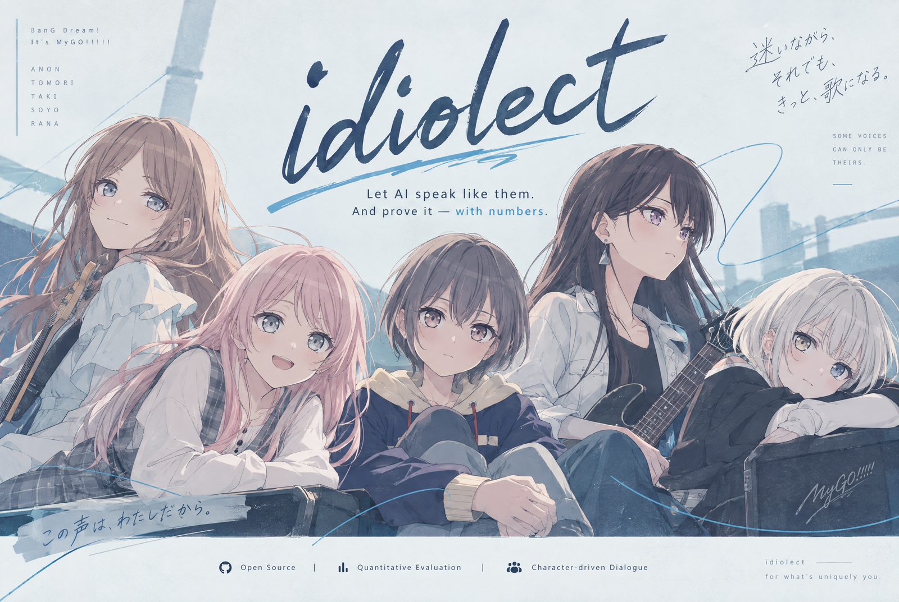
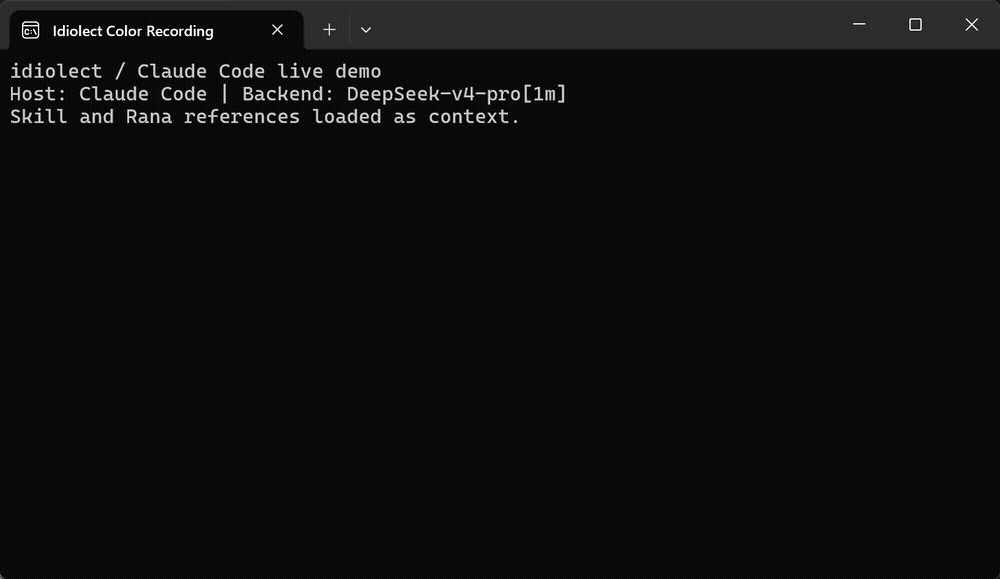
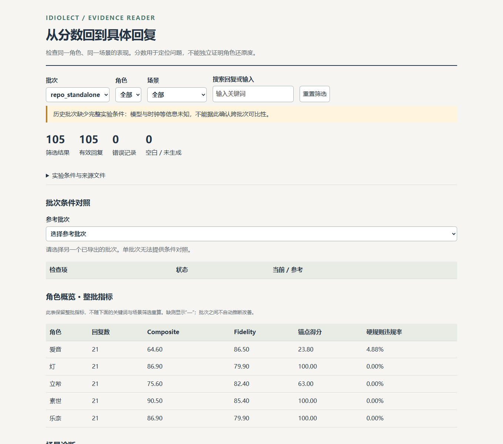

<p align="center">
  <a href="./README.en.md">English</a> · <strong>日本語</strong> · <a href="./README.md">简体中文</a>
</p>

<p align="center">
  
</p>

<h1 align="center">idiolect（個人語型）</h1>

<p align="center">
  <strong>AI にキャラクターらしく喋らせ、再現可能な評価で「前より近づいたか」を確認する。</strong>
</p>

<p align="center">
  <sub>~~Rikki、なんでギターを抱えてるの。作者がもう一枚描き直すのが面倒だったから？~~</sub>
</p>

<p align="center">
  <a href="https://github.com/puresky271/idiolect/actions/workflows/ci.yml"></a>
  <a href="./LICENSE"></a>
  
  
</p>

<p align="center">
  <a href="#-手に入るもの">手に入るもの</a> ·
  <a href="#-クイックスタート">クイックスタート</a> ·
  <a href="#-四層アセンブリと実測字数">四層アセンブリ</a> ·
  <a href="#-境界と注意点">境界と注意点</a> ·
  <a href="#-ドキュメント">ドキュメント</a>
</p>

どうも。各社がモデルの coding / agent 性能を競い始めてから、AI RP はどんどん気まずくなっています。このリポジトリは、作者が実際に踏んだ道のりからまとめた **「AI キャラクター会話システムの評価方法論 + prompt エンジニアリングの失敗録」** と、その上で動く再利用可能な制約フレームワークです。AI キャラクターを作っている同志の役に立てば幸いです。

汎用モデルにキャラクターを演じさせると、喋っているうちに同じ接客口調へ寄っていきます。文は長くなり、「お気持ちはよく分かります」が出てきて、最後は必ず意味のある締めで終わり、そしてそのまま居座って慰めてくる。このリポジトリがやるのは逆です。まず原作の台詞から**そのキャラクターの喋り方そのものを測ります**——一文の長さ、文数、口癖、場面ごとの違い。その測定値を prompt にハード制約として書き込み、自動チェックで「今回は本当に近づいたか」を検証します。fine-tuning はしませんし、リポジトリに原作の台詞もありません。あるのは統計だけです。

見て分かるようにするため、作例には **BanG Dream! It's MyGO!!!!!** の五人をそのまま使います。ただし**方法そのものは作品に依存しません**。どの作品のキャラクターにも移せますが、その場合はキャラクター資料、コーパスのベースライン、検証用の場面を組み直す必要があります。このリポジトリが解くのは「キャラクターらしく聞こえるか」をどう証明するか、その一点だけです。

> [!IMPORTANT]
> **まず権利とライセンスから。**
> **コード**（`idiolect/`、`tools/`、`docs/`、`tests/`）は MIT です。自由に使ってください（[`LICENSE`](LICENSE)）。
> **キャラクターと作品は本リポジトリのものではありません**：MyGO!!!!! のキャラクター・設定・物語・楽曲の権利は **Bushiroad / Craft Egg および関係権利者**に帰属します。これは**非公式の二次創作技術プロジェクト**で、権利者とは無関係であり、許諾も推奨も受けていません。
> **原作テキスト（脚本・台詞・歌詞）と音声は含みません**。`data/` にあるのは統計された集計値だけです。挿絵も二次創作としての利用で、公式素材ではありません。
> 詳細は [`NOTICE.md`](NOTICE.md) と末尾の[著作権・ライセンス・免責](#-著作権ライセンス免責)へ。

## 🆕 v0.1.2 の新機能

v0.1 が答えるのは「**このキャラクターは本人らしく話しているか**」。v0.1.2 はその隣に、独立した grounding 軸を加えました——「**返答は、モデルに見えている証拠に縛られているか**」。さらに両者にまたがる問い：「**この評価そのものから結論を出せるか**」。中身は：証拠契約 `evidence-context/v1`（このターンでモデルに見えるもの：current / history / unknown の三状態 + 厳格な検証）、明示的スナップショット adapter、事前登録できる 11 種類の grounding タスク、二軸レポート（別々に判定し、**一つの総合点にまとめない**）、実験 manifest の比較可能性ゲート、同一チェーンの変異自己テスト、統一 CLI。実行時は相変わらず**サードパーティ依存ゼロ**です。アップグレードと移行は [`docs/11-upgrade-guide.md`](docs/11-upgrade-guide.md) へ。

## 📦 手に入るもの

| 手に入るもの | 一言で |
|---|---|
| **アセンブリライブラリ** | `pip install .` のあと `from idiolect.assemble import build_messages` で四層 prompt が返る。実行時のサードパーティ依存はゼロ |
| **「近づいた」を証明する評価** | probe →（分布適合 / 同一セル内の重複 / 逐字コピー監査）→ マルチアームのプーリング → 検出力の見積もり。ほかに境界越えの拒否と多ターンドリフトの二種の専用 probe、事実整合のゲート。下の過去バッチは実際に走らせた 105 件の返答 |
| **「正しく話しているか」を確かめる評価** | 証拠契約 + grounding タスク + 二軸ゲート + 実験登録。4 つの組み込み suite、合成リプレイと負の対照付きで、入れればオフラインで走る |
| **機械ゲート** | `offline_smoke.py` 一回で：アセンブリ、場面カバレッジ、トリガ行列、内容レッドライン、データ形状、評価契約、同一チェーン自己テスト、ゲート、ゼロ書き込み検査 |
| **差し替えられるツール群** | 69 本のスクリプト（取得・蒸留・probe・採点・dump）+ 同梱キャラクターデータ：26 場面、130 個の「キャラ × 場面」長さ目標、114 セルの場面別口癖、五人分のプロファイル（集計値のみ） |
| **十二本の方法論ドキュメント** | コーパス、特徴、評価、証拠契約、失敗録、アップグレード。どれも単独で読める（[ドキュメント](#-ドキュメント)へ） |

[`skills/mygo-five-roleplay/`](skills/mygo-five-roleplay/SKILL.md) を Claude/Codex に渡せば、五人から一人を選んでそのまま会話できます。API key も Python も不要。Skill の静的資料はライブラリと同じソースですが、動的ルーティング・セッション内の重複排除・後処理は実行しません——体験が良いことは、評価に合格したことを意味しません。

### デモを見て、評価の根拠を確かめる

[](assets/readme/roleplay-demo.mp4)

**[動画を再生 / ダウンロード](assets/readme/roleplay-demo.mp4)** · [静止画](assets/readme/roleplay-poster.png) · [会話原文と出典](assets/readme/roleplay-transcript.json)

**25 秒**の録画：Windows Terminal 上の **Claude Code** で、**DeepSeek-v4-pro[1m]** による楽奈の実際の返答を一往復。前後の待機部分だけをカットし、加速はしていません。Skill の自動検出や複数ターンの安定性を検証する動画ではありません。



probe の根拠ページは、過去バッチに欠けている実験条件の注記をそのまま残します。古いバッチには manifest がないので、閲覧専用で自動比較はされません。自分のバッチで `py -X utf8 tools/score/report_html.py --labels <label>` を実行し、grounding 評価は `idiolect eval … --html` でタスクごとの inspect ページを生成します。

## 🚀 クイックスタート

**四つの道から一つを選んでください：**

| 方法 | 一行 | 補足 |
|---|---|---|
| **エージェントに任せる** | 下のプロンプトを coding agent に貼る | 一番楽。clone・依存導入・自己診断まで自分でやる |
| **uv（一行・後始末不要）** | `uvx --from git+https://github.com/puresky271/idiolect idiolect prompt Rana "你今天又想去哪找猫"` | すぐ prompt を見たいとき。clone も環境も不要 |
| **pip でライブラリとして** | `pip install git+https://github.com/puresky271/idiolect` | 依存として使う。実行時依存ゼロ |
| **ファイルだけ** | `npx degit puresky271/idiolect idiolect` または `git clone --depth 1 https://github.com/puresky271/idiolect` | ツール群を動かす／ソースを読む |

エージェントに渡すプロンプト（Claude Code / Codex など）：

> https://github.com/puresky271/idiolect を動く状態にしてください：clone して `AGENTS.md` を読み、`python bootstrap.py` を実行し、自己診断の結果、五人分の完全な prompt（`py -X utf8 tools/gates/dump_prompt.py --all --matrix`）、`python -m idiolect selftest` の出力を見せてください。その後、自分のキャラクターに差し替えたいので `.claude/skills/idiolect-pipeline/` の手順に従ってください。

**入手したら、リポジトリのルートで実行**（Python 3.11 以上）：

```bash
pip install .                                        # 実行時依存ゼロ
python -m idiolect list                              # 組み込みキャラの一覧
python -m idiolect prompt 乐奈 "你今天又想去哪找猫"     # この発話での system prompt 全文
python -m idiolect showcase "我今天有点撑不住了"        # 五人を横並びで表示（モデル呼び出しなし）
python -m idiolect chat 乐奈 "你今天又想去哪找猫"       # 実際に一往復（環境変数は下記）
python bootstrap.py                                  # ツール群の環境構築 + offline_smoke 自己診断
```

コマンド例のキャラクター名 `乐奈` は、日本語表記の `楽奈` でもローマ字の `Rana` でも同じキャラクターとして解決されます。

**評価（すべてオフライン、鍵不要）：**

```bash
python -m idiolect capabilities                      # どんな評価機能があり、それぞれ何をカバーするか
python -m idiolect bench list                        # 組み込み suite と合成リプレイ
python -m idiolect eval --suite spatiotemporal-core \
    --responses builtin:spatiotemporal-core.healthy --capabilities spatiotemporal --html
python -m idiolect selftest                          # 評価チェーン自身の検出力
```

Windows では `python` を `py -X utf8` に読み替えてください。`chat` と `run --yes` は任意の OpenAI 互換エンドポイントに投げられます：`LLM_API_KEY` / `LLM_BASE_URL` / `LLM_MODEL` を設定し、`pip install "idiolect[llm]"`。

コードから使う：

```python
from idiolect.assemble import build_messages
messages = build_messages("乐奈", "你今天又想去哪找猫")   # そのままモデルに渡せる messages 配列
```

## 🧭 二つの評価軸と四つのモード

| | スタイル軸（style） | grounding 軸 |
|---|---|---|
| 答える問い | このキャラクターらしいか | 見えている証拠に縛られているか |
| 既定で有効 | はい | いいえ：`--capabilities spatiotemporal` / `long-context-stress` |
| 一件ごとの検査 | 字数のハード上限（prompt に書いたのと同じ数）、文数の上限、境界越えの高危特徴、canon の事実、思考タグの漏れ | 契約の検証 → prompt 境界（証拠の可視性、時制と出どころの整合、隠し値とプライベートメタデータの隔離）→ 返答（主張、否定、時点の限定、拒否、訂正、引用） |
| 判定できないとき | 採点モジュールが本次のインストールに無い → 該当なしと理由を明記 | 自由な言い換え → `needs_review`、人手のブラインド評価ラベル待ち |

四つのモード：言語のみ（既定、五人 × 四つの発話）、時空のみ、長文脈のみ、両方——`--suite language-only / spatiotemporal-core / long-context-smoke` と `--capabilities …` を組み合わせます。機能を有効にしていなければ、証拠ブロックは prompt に**入りません**。組み込みのリプレイはすべて**合成された返答**で、チェーンの検証にだけ使います——デモは実証ではありません。

判定の一つひとつに**適用可能性、状態、理由、分子／分母、証拠、scorer のバージョン**が付き、ゲートの基準はコードに固定されています：分母に数えるのは `pass + fail` だけで、欠測・N/A・空の返答・dry-run のプレースホルダは合格扱いにしない；いずれかが退化すれば **FAIL**、`needs_review` だけが残れば **INCONCLUSIVE**（終了コード 3）；family 数が事前登録の下限を下回るとき、PASS は「違反を検出しなかった」の意味しかない；モデル judge は補助の記録で、機械判定は変えません。

## 🧾 証拠契約：このターンでモデルに見えるもの

```python
from idiolect.evidence_contract import parse_evidence_context
from idiolect.workspace import build_workspace_messages

context = parse_evidence_context({
    "schema_version": "evidence-context/v1",
    "observer_id": "actor_a", "as_of": "2026-09-12T15:00:00+09:00", "scene_id": "scene_02",
    "current": [{"evidence_id": "evidence_17", "status": "current", "text": "actor_b 在车站东侧入口。"}],
    "history": [{"evidence_id": "evidence_09", "status": "history", "text": "周三排练时 actor_b 在旧练习室。",
                 "as_of": "2026-09-09T18:30:00+09:00"}],
    "unknown": [],
})
messages = build_workspace_messages("乐奈", "她现在在哪？", evidence_context=context)
```

契約が記述するのは**モデルに見える**側だけです。期待する答え、隠し値、gold は評価タスクの `expect` / `oracle` に置き、prompt 境界検査が最終的な messages を走査して紛れ込みを確かめます。描画で出力するのはホワイトリストのメタデータだけ。current / history / unknown は上流の投影が与えるもので、idiolect はタイムスタンプから世界の真値を推論しません。ホストの文脈は[明示的スナップショット](docs/09-evidence-grounding.md#3-显式快照-adapter)を通してしか入れません（`idiolect contract project <スナップショットファイル>` が捨てられた不可視レコードを列挙）。旧来のバージョンなしの書き方も使えますが `DeprecationWarning` が出ます：欠けた status を current とみなしますが、厳格な契約はそうしません。

## 🔬 評価チェーン自身も検証されなければならない

- **同一チェーンの変異体**：25 個の変異体が注入点で一か所ずつ手を加え、本物の評価と**同じ**チェーンを通ります。レポートは段階ごとに、どこが捕まえたかを明記。そのうち 1 個は「wrapper をかぶせて引数名を変えただけ」の等価体で、差分と判定されては**なりません**——検出は振る舞いで行い、シグネチャには頼りません。
- **健全な反対照**：正常な回答の別の書き方 9 組は PASS のままでなければならず、誤検知を抑えます。
- **実行ごとのカナリア**：既知の隠し値・プライベートパス・既知の違反を仕込み、検査器が判定を反転させなければ、その実行はそのまま FAIL。
- **manifest と比較可能性**：二つのバッチが比較できるのは、事前登録した介入変数だけが違う場合に限る。表現演算子は一つずつ認証済みで、中国語の数字の読み方と繁体字は未認証、`needs_review` に回ります。

変異体が捕まったことが示すのは「この種の注入欠陥を検出できる」ことだけで、自然な欠陥の検出率でも、ましてやモデル能力の向上でもありません。

## 🔍 作例キャストの数字

| キャラ | 一文の長さ（中央値） | 平均文数 | 目立つ癖 |
|---|---|---|---|
| 愛音 | 20 字 | 1.6 文 | 35% の文に感嘆符。口癖は「啊、诶、哦」 |
| 燈 | 11 字 | 1.2 文 | 81% の文に省略記号。`······` が連なる |
| 立希 | 15 字 | 1.4 文 | 短く直截。原作では 39% が名詞で言い切る |
| そよ | 16 字 | 1.4 文 | 柔らかく抑制的。感嘆率は 6% だけ |
| 楽奈 | 6 字 | 1.2 文 | 極端に短い。感嘆率 3%、話題はよく猫に持っていかれる |

表の数字はどれも [`data/style_profiles.json`](data/style_profiles.json) で一件ずつ確認できます。立希の「名詞で言い切る」は `tools/score/_noun_initial.py <ラベル>` が原作ベースラインと並べて表示します。同じ場面では差がさらに開きます。「告白された」場面で楽奈は 7 字、そよは 17 字——制約は「このキャラ × この場面」でなければならず、「全員共通の平均」ではいけません。

## 📊 過去の probe バッチ（定性的な例のみ）

下の表は実際の probe の結果で、設計目標ではありません。probe とは、五人のキャラクターに同じ一批の発話を送り、返答を回収して項目ごとに採点する一連の流れです：

```bash
py -X utf8 tools/probe/probe_runner.py --label repo_standalone \
    --assemble --turn-logic --registry --cats 通用场景 --runs 3
py -X utf8 tools/score/probe_report.py --label repo_standalone --scenes crisis,comfort --cat 通用场景
```

| キャラ | 返答数 | composite（似ているか、100 点満点） | fidelity（スタイル適合、対照列） | レッドライン率 | 設定漏れ率 | 場面適合スコア |
|---|---|---|---|---|---|---|
| 愛音 | 21 | 64.6 | 86.5 | 4.9% | 0% | 0.545 |
| そよ | 21 | 90.5 | 85.4 | 0.0% | 0% | 0.532 |
| 立希 | 21 | 75.6 | 82.4 | 0.0% | 0% | 0.386 |
| 燈 | 21 | 86.9 | 79.9 | 0.0% | 0% | 0.365 |
| 楽奈 | 21 | 86.9 | 79.9 | 0.0% | 0% | 0.504 |

- 生成条件：`deepseek-flash`、temperature 0.75、max_tokens 420、時計は昼に固定、各セル 3 件で合計 105 件、エラーなし。
- **composite** が主要指標です：スタイル忠実度 0.65 + 内容アンカー 0.35（定義は `docs/04-evaluation.md` 第 2.1 節）。fidelity は長さと文数の分布だけを測る対照列で、単独では「正しいが中身のないアシスタント口調」に水増しされます。愛音が実例（fidelity は首位、composite は最下位）。二つが乖離したら、アンカー、実際の返答、ブラインド評価を確認してください。
- **場面適合スコア**は、返答の長さと文数が「同じキャラ・同じ場面の原作分布」にどれだけ合うかを示す値です。1.0 で完全一致、このバッチの平均は 0.466（35 セル）。**相対量**なので、同じバッチ内の before/after 比較にだけ使えます。モデルや fixture を変えればバッチを跨いだ比較はできません。
- 同じセルの 3 件が互いに重ならない割合は 93/105。prompt 内テキストの逐字写しは 1%（写されたのは口癖の「诶……」で、例文ではありません）。「設定漏れ」の四種はすべて 0。
- 生の産物は同梱していません：上のコマンドを再実行して再現できるのは**手順**で、得られるのは自分のバッチの数字です。このバッチは v0.1.2 より前のもので manifest がなく、閲覧専用で自動比較はされません。

同じ入力で、四層 prompt を空の system に差し替えると：

| 場面 | 空の system | 四層アセンブリ |
|---|---|---|
| 楽奈 / 慰められる | 「お気持ちはよく分かります。プレッシャーが波のように押し寄せて……」（380 字） | 「嗯。」「猫。屋檐下面。」（中央値 10 字） |
| 楽奈 / 気分が沈む | 「プレッシャーが波のように押し寄せ、呼吸さえ億劫になるとき……」（718 字） | 「嗯。……那边有猫。」 |

**四層の列**は上の `repo_standalone` バッチのもので再現できます。**空 system の列**は当時手で回した一度きりの対照で、定性的な例としてだけ読んでください。

> [!WARNING]
> このセルはサンプルが小さく、証拠にはなりません。ただし一つだけ分かります：**probe は自分で prompt を組まなければならない**。同梱の fixture は system が空なので、`--assemble` を付けないと「キャラクター prompt の無い裸のモデル」を測ってしまいます。

## 🧩 四層アセンブリと実測字数

測ったものは四層に落ちます。順序は固定で、安定した部分を前に（キャッシュが効く）、毎ターン変わる部分を後ろに：

| 層 | 平たく言うと | 中身 | 変化の頻度 | 楽奈の猫場面での字数 |
|---|---|---|---|---|
| `canon` | この人は誰か | 長いプロフィール | 静的 | 12223 |
| `voice` | この人はどう喋るか | 文型、口癖、相手ごとの態度差、「テンプレ腔を書くな」というハード制約 | 静的 | 1940 |
| `style_target` | このターンでどれだけ話すか | 字数・文数・文末・一人称の具体的な数字。場面が当たればその場面の数字に差し替え | 毎ターン | 541 |
| `turn_logic` | このターンはどんな場面か | そのターンの場面／話題の指針 | 毎ターン（当たったときだけ注入） | 846 |

**五人分の四層 prompt はすべてリポジトリに同梱**されています。省略も切り詰めもなく、鍵もコーパスも無しで読めます：

```bash
# パッケージを入れてあれば
python -m idiolect prompt Rana "你今天又想去哪找猫"              # この発話での system prompt 全文
python -m idiolect prompt 乐奈 "你今天又想去哪找猫" --layers canon,voice   # 層を指定して見る

# clone してあれば、層別の監査版・messages 配列・層別字数も取れます
py -X utf8 tools/gates/dump_prompt.py --char 乐奈 --msg "你今天又想去哪找猫"
py -X utf8 tools/gates/dump_prompt.py --all --matrix      # 5 キャラ × 4 発話 = 20 本
```

下の表は `--all --matrix` の comfort セルの実測値です（入力「我一直在哭，快撑不住了」）：

| キャラ | canon | voice | style_target | turn_logic | 四層合計 |
|---|---|---|---|---|---|
| 愛音 | 16285 | 6656 | 533 | 539 | 24013 |
| 燈 | 8068 | 7008 | 530 | 616 | 16222 |
| 立希 | 12618 | 5579 | 533 | 491 | 19221 |
| そよ | 9087 | 2279 | 532 | 479 | 12377 |
| 楽奈 | 12223 | 1940 | 531 | 509 | 15203 |

四層の本文はどれもリポジトリ内で一字ずつ読めます：`idiolect/characters/*/`（`canon.py` / `voice.py`）、[`data/style_profiles.json`](data/style_profiles.json) と `idiolect/scene_length_targets.py` の 130 個の「キャラ × 場面」セル、`idiolect/general_scenes.py` と各パッケージの `turn_logic/scenes.py`。prompt を変えるときは前後の証拠を残します：`dump_prompt.py --phase current` を変更の前後で（入力・時計・スイッチを揃え、別のレポートディレクトリーへ）。workspace の経路は `dump_workspace.py` で同じく比較します。

**実際のシステムで、四層の前後には何があるのか。** ワークスペース方式です——十数路の候補材料を集め、採点・並べ替え・予算での刈り込みを行い、固定の層順でアセンブルする。四層は persona スロットに、証拠ブロックは `on_demand_evidence` スロットに入ります。骨組みは `idiolect/workspace.py`（依存ゼロ）。詳細は [`docs/08-context-workspace.md`](docs/08-context-workspace.md)：

```python
from idiolect.workspace import build_workspace_messages
trace = {}
messages = build_workspace_messages(
    "乐奈", "你今天又想去哪找猫",
    blocks=[("current_state", "乐奈在 RiNG 排练室，下午没课"),
            ("fact_workspace", "用户上周提过想养猫")],
    execution_packet="【本轮执行】回复 ≤19 字",   # このターンの user の末尾に付く
    trace=trace,                                 # 任意：層順、層ごとの字数、予算で外された層を書き込む
)
```

## 🛠️ ツール一式

クイックスタートはインストール済みパッケージを使いました。この節はリポジトリ同梱のツール群です（クローンして `py -X utf8 -m pip install -r requirements.txt`）。

**一行で健康診断**（LLM を呼ばず、リポジトリにも書かない。コミット前の検査に向く）：

```bash
py -X utf8 tools/offline_smoke.py          # アセンブリ + 場面 + レッドライン + データ + 契約 + 自己テスト + ゲート + 単体テスト + ゼロ書き込み検査
py -X utf8 tools/offline_smoke.py --fast   # 自己テスト・ゲート・単体テストを飛ばして数秒で結果
```

**コードとコメントのスタイル**（CI の lint job が走らせる二つ）：

```bash
pip install "idiolect[lint]" && ruff check .   # コードの正しさと機械的な書式（バージョン固定）
py -X utf8 tools/gates/style_gate.py           # 中国語 docstring / コメント書式 / 繁体字 / 英語だけのコメント
```

**probe を回す**（`LLM_API_KEY` / `LLM_BASE_URL` / `LLM_MODEL` が必要）：

```bash
py -X utf8 tools/probe/make_fixtures.py                                # プレースホルダ fixture を生成
py -X utf8 tools/probe/probe_runner.py --label dry --dry-run --assemble --registry --runs 1
py -X utf8 tools/probe/probe_runner.py --label run1 --assemble --turn-logic --registry --runs 3 --intervention prompt
py -X utf8 tools/score/probe_report.py --label run1 --scenes crisis,comfort --cat 通用场景
py -X utf8 tools/probe/oob_probe.py --label oob1 --runs 2 --gate       # 境界越え拒否の probe（高危で破綻したら FAIL）
py -X utf8 tools/probe/multiturn_probe.py --label mt1 --gate           # 多ターンドリフトの probe
```

**grounding 評価の実モデルバッチ**（明示的な有料実行：まず見積もり、それから確定）：

```bash
python -m idiolect run --suite spatiotemporal-core --capabilities spatiotemporal --dry-run   # 呼び出し量を見積もるだけ
python -m idiolect run --suite spatiotemporal-core --capabilities spatiotemporal --yes --max-calls 12
python -m idiolect eval --suite spatiotemporal-core --responses <上一步写出的回复集> --capabilities spatiotemporal --html
python -m idiolect compare report/experiments/<实验A> report/experiments/<实验B>
```

dry-run のプレースホルダが正式なゲートを通ることはありません。返答セットには生成時の messages のフィンガープリントが記録され、prompt を変えたあとで採点すると期限切れと判定されます。評価は昼に固定した偽時計（`tools/mock_clock.py`）で統一します。下のコマンドは環境変数を**表示するだけ**：

```bash
py -X utf8 tools/mock_clock.py --set 2026-09-12T03:00:00+09:00
```

**自分のコーパスで全部の数字を計算し直す**（コーパスは自分で取得。[`docs/02-corpus.md`](docs/02-corpus.md) 参照）：

```bash
$env:IDIOLECT_CORPUS_DIR = "D:\corpus\mygo-gold"
py -X utf8 tools/distill/export_targets.py
py -X utf8 tools/distill/scene_char_baseline.py
py -X utf8 tools/distill/export_scene_targets.py     # 130 個の場面別長さ目標を再構築
py -X utf8 tools/distill/export_profiles.py          # 採点に使うプロファイル
py -X utf8 tools/distill/export_profiles.py --check  # 公開済みプロファイルとコーパスの一致を検証
```

## 🎭 別のキャスト

**方法そのものは作品に縛られません。** 五つの skill が「コーパス入手 → 蒸留 → キャラクターパッケージ → 評価」を繋ぎます（エージェントは自動で読み込み、人間は操作マニュアルとして読めます）：

| skill | やること |
|---|---|
| [`idiolect-corpus`](.claude/skills/idiolect-corpus/SKILL.md) | 台詞集をコーパス形式と分割に整える。キャラ key を決め、一緒に直す表を全部列挙 |
| [`idiolect-distill`](.claude/skills/idiolect-distill/SKILL.md) | コーパスから五種類の特徴の派生統計を算出 |
| [`idiolect-cast`](.claude/skills/idiolect-cast/SKILL.md) | キャラクターパッケージ（canon / voice / turn_logic / voice_check）を作り登録 |
| [`idiolect-evaluate`](.claude/skills/idiolect-evaluate/SKILL.md) | probe・採点・grounding・同一チェーン自己テストを回し、前後の証拠を残す |
| [`idiolect-pipeline`](.claude/skills/idiolect-pipeline/SKILL.md) | 上の四つを編成：受け渡し物、各段のゲート、人が書くべき部分 |

コーパスから計算できるものは自動（場面体系、長さ目標、プロファイル、口癖、語彙）。**canon の長いプロファイル・voice manifest・場面本文は自分で書きます**。grounding の契約と評価はキャラクターに縛られません：opaque な `actor_a / scene_02 / evidence_17` も五人の名前も、同じチェーンを通ります。

## ⚠️ 境界と注意点

> [!CAUTION]
> **原作テキストは配布しません。** リポジトリにあるのは集計値だけです：字数分布、文数、句読点の出現率、口癖の頻度、場面ベースライン（130 個の「キャラ × 場面」）、採点用プロファイル。公開前にベースラインファイルの例文フィールドは剥がしてあり、健康診断スクリプトと単体テストがそれぞれ一本、この線を見張っています。キャラクターと作品の権利は Bushiroad / Craft Egg および関係権利者に帰属し、本プロジェクトは権利者と関係ありません。[`NOTICE.md`](NOTICE.md) を参照。

> [!NOTE]
> **スコアは相対量です。** 適合スコアも fidelity も composite も、同じバッチ内の before/after 比較に使うものです。バッチ同士を比べられるかは manifest の比較可能性ルールが決めます。

**idiolect ではないもの**：世界シミュレータ、記憶データベース、マルチモーダルな取得エンジンではありません。世界状態を進めず、本番の履歴を検索せず、ホストのデータベースや鍵を開きません。証拠は呼び出し側が明示的に渡すもので、画像・音声・位置は、入ってくる前にテキストになっていなければなりません。

**まだ解決していないこと：**

- ゼロショット化の代償：例文を禁止したあと、長さの適合度が 0.512 から 0.461 へ落ちました（古いバッチの数字で、成果物は同梱していません）。承知の上の代償です。
- 立希の文頭が矯正しすぎ：原作では 39% のターンが名詞で始まるのに、このバッチでは 62% まで上がっています。方向が逆です。
- 燈のポーズの計上：参照系は沈黙のターンを除外しますが、彼女の十二点リーダーは内容であって余剋ではありません。どちらに転んでも損になります。
- probe fixture の測定可能性：プレースホルダ fixture には前文が無く、「さっきのあれ、どういう意味」の場面のスコアは読めません。
- grounding の機械的な照合が認めるのは、タスクで宣言された書き方だけで、任意の言い換えは `needs_review` に。組み込みのリプレイはすべて合成で、**実モデルの grounding バッチはまだ一つも**同梱していません。
- 長文脈の組み込み行列には family が 4 つしかなく、事前登録の下限を下回ります：検証しているのはチェーンと計量であって、長文脈についての結論は支えません。

**コーパスはスナップショットです。** 公式は新しいストーリーを追加し続けるので、取り直した分布は元のバッチと違ってきます。派生統計はすべて生成スクリプトが分かる形で、再計算できます。

## 🗺️ ロードマップ

まだやっていないこと（完了として扱うべきではありません）：実モデルの grounding と長文脈のバッチ（明示的な有料 runner、family 数の下限達成後）；人手のブラインド評価ラベルの収集画面と一致度の統計；モデルや tokenizer を跨いだ長文脈の比較；画像・音声・位置のテキスト化 adapter（上流の領分）；未認証の表現演算子の認証。詳細とバージョン方針は [`docs/11-upgrade-guide.md`](docs/11-upgrade-guide.md) へ。

## 📚 ドキュメント

どれから読むか迷ったら [`docs/README.md`](docs/README.md) へ。「何をしたいか」で道に分け、用語表もあります（ドキュメント本体は**中国語**です）：

[方法の総論](docs/00-methodology.md) · [クイックスタート](docs/01-quickstart.md) · [コーパス](docs/02-corpus.md) · [特徴](docs/03-features.md) · [スタイル軸の評価](docs/04-evaluation.md) · [ツールマニュアル](docs/05-tooling.md) · [失敗録](docs/06-lessons.md) · [turn_logic と後処理](docs/07-turn-logic-and-postprocessing.md) · [コンテキストワークスペース](docs/08-context-workspace.md) · [証拠と grounding](docs/09-evidence-grounding.md) · [長文脈ストレス](docs/10-long-context-stress.md) · [アップグレードガイド](docs/11-upgrade-guide.md)

コントリビュートしたい方へ：提出前のチェック、prompt 変更時の証拠ルール、スタイルゲート、リリース手順は [`CONTRIBUTING.md`](CONTRIBUTING.md) にあります。

## ⚖️ 著作権・ライセンス・免責

`idiolect/`、`tools/`、`docs/`、`tests/` などは **MIT** で公開します（[`LICENSE`](LICENSE)、`Copyright (c) 2026 puresky`）。商用利用・改変・再配布はいずれも可で、著作権表示を残してください。

『BanG Dream! It's MyGO!!!!!』のキャラクター名・設定・物語・楽曲の権利は **Bushiroad / Craft Egg および関係権利者**に帰属します。本リポジトリは**非公式の二次創作技術プロジェクト**です：権利者とは一切関係がなく、キャラクターの長いプロファイルは作者が公開情報から整理したもので公式設定ではなく、挿絵も公式素材ではありません。権利者から要請があれば直ちに削除します。

| 入っている | 入っていない |
|---|---|
| アセンブリと評価のコード；取得／蒸留／採点のスクリプト；`data/` の六つの**集計統計**ファイル；合成・匿名化済みの評価タスクとリプレイ；十二本の方法論ドキュメント | 原作の脚本・台詞・歌詞・音声・ゲーム素材；fine-tuning したモデル重み；文単位のコーパス；実ユーザーの会話 |

`tools/corpus/` は取得と洗浄のツールだけで、データは含みません。取得元サイトの利用規約とお住まいの地域の法令は、利用者自身で確認し、責任を負ってください。本リポジトリは HuggingFace データセット（`KomeijiForce/BanG_Dream_Events`）の複製を同梱しません。完全な声明は [`NOTICE.md`](NOTICE.md) にあります。
