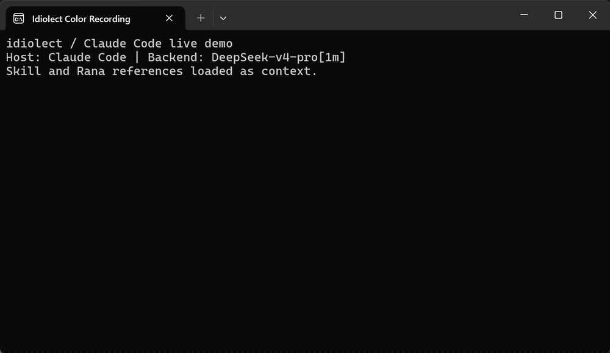
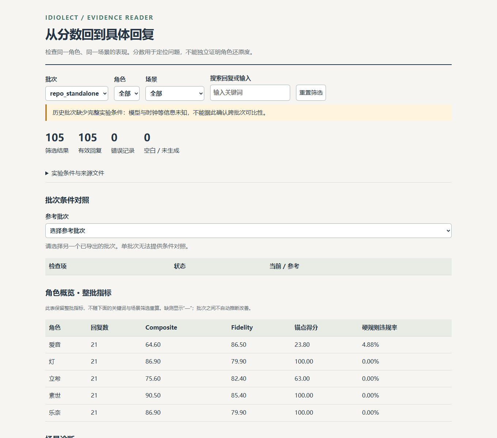

<p align="center">
  <a href="./README.en.md">English</a> · <a href="./README.ja.md">日本語</a> · <strong>简体中文</strong>
</p>

<p align="center">
  
</p>

<h1 align="center">idiolect（个人语型）</h1>

<p align="center">
  <strong>让 AI 扮演角色时说话像本人，再用可复现的评测检查它是不是真的更像了。</strong>
</p>

<p align="center">
  <sub>~~Rikki，为什么你抱着吉他——是因为作者太懒，不想再重跑一张图吗~~</sub>
</p>

<p align="center">
  <a href="https://github.com/puresky271/idiolect/actions/workflows/ci.yml"></a>
  <a href="./LICENSE"></a>
  
  
</p>

<p align="center">
  <a href="#-拿到手能做什么">拿到手能做什么</a> ·
  <a href="#-快速跑起来">快速跑起来</a> ·
  <a href="#-四层装配与实测字数">四层装配</a> ·
  <a href="#-边界与提醒">边界与提醒</a> ·
  <a href="#-文档">文档</a>
</p>

孩子们，随着现在的厂商越来越追求model在coding和agent方面的能力，我们的AI RP真是越来越难绷了啊，本仓库是基于作者的部分经验总结出来的一份“AI 角色扮演对话系统的评测方法学 + prompt 工程踩坑实录”，外加一套可复用的约束框架，希望能帮到想做AI角色的同好们。

用通用模型扮演角色，聊着聊着就会滑向同一副客服腔：话越说越长、动不动来一句「你的感受我完全能理解」、结尾还要升华一下，然后稳稳地接住你。本仓库的做法反过来：先从角色原本的台词里**量出 ta 说话的习惯**——一句话多长、一次说几句、爱用什么口头禅、什么场合说什么话——再把这些数字写成 prompt 里的硬约束，最后用自动检查验证「这次是不是真的更像了」。不做微调，仓库里也没有原作台词，只有统计出来的数字。

为了让方法看得见摸得着，全程拿《BanG Dream! It's MyGO!!!!!》的五名成员做**示例角色**。**方法可以迁移到别的作品**，但角色资料、语料基线和验证场景都得重建；这里只解决一件事——怎么证明「说话像」，并且把它做成一套独立、可复现的流程。

> [!IMPORTANT]
> **先把权利与许可说清楚**
> **代码**（`idiolect/`、`tools/`、`docs/`、`tests/`）以 MIT 发布，随便用（[`LICENSE`](LICENSE)）。
> **角色与作品不属于本仓库**：MyGO!!!!! 的角色、设定、剧情与音乐的权利归 **Bushiroad / Craft Egg 及相关权利方**。这是一个**非官方同人技术项目**，与权利方没有关联，也未获授权或背书。
> **仓库不含任何原作文本**（剧本、台词、歌词）与音频，`data/` 里只有统计出来的聚合数字；示例插画属于同人性质的使用，不是官方素材。
> 完整说明见 [`NOTICE.md`](NOTICE.md) 与文末的[版权、许可与免责](#-版权许可与免责)。

## 🆕 v0.1.2 带来了什么

v0.1 回答「**像不像这个角色**」；v0.1.2 在它旁边加了第二条独立的 grounding 轴——「**回答有没有被它能看到的证据约束住**」，再加一个横跨两者的问题：「**这项评测本身能不能下结论**」。落地为：证据合同 `evidence-context/v1`（这一轮模型能看到什么：current / history / unknown 三态 + 严格校验）、显式快照 adapter、11 类可预注册 grounding 任务、双轴报告（分开判定，**不合成总分**）、实验 manifest 可比性门禁、同链变异自测与统一 CLI。运行时仍是**零第三方依赖**。升级与迁移见 [`docs/11-upgrade-guide.md`](docs/11-upgrade-guide.md)。

## 📦 拿到手能做什么

| 你能拿到 | 一句话 |
|---|---|
| **装配库** | `pip install .` 后 `from idiolect.assemble import build_messages` 拿到四层 prompt；运行时零第三方依赖 |
| **证明「更像了」的评测** | 探针 →（分布贴合 / 同格重复 / 逐字复述）三件套 → 多臂池化 → 功效估算；另有越界拒答与多轮漂移两个专项探针、事实一致性门禁。下方历史批次就是一次真跑的 105 条回复 |
| **检查「说得对不对」的评测** | 证据合同 + grounding 任务 + 双轴门禁 + 实验登记；4 个内置 suite、合成回放与负对照，装好包就能离线跑 |
| **机械门禁** | `offline_smoke.py` 一条命令：装配、场景覆盖、触发矩阵、内容红线、数据形状、评测合同、同链自测、门禁与零写校验 |
| **可换作品的工具链** | 69 个脚本（抓取、蒸馏、探针、评分、dump）+ 现成角色数据：26 场景、130 个「角色 × 场景」长度目标、114 格场景口癖、五人画像（只有聚合量） |
| **十二篇方法论文档** | 语料、特征、评测、证据合同、踩坑、升级，各自独立可读（见[文档](#-文档)） |

把 [`skills/mygo-five-roleplay/`](skills/mygo-five-roleplay/SKILL.md) 交给 Claude/Codex 就能选五人之一直接对话，不需要 API key 和 Python。Skill 的静态资料与库同源，但不执行动态路由、会话去重与后处理——体验好不等于评测过关。

### 看一段演示，再检查证据

[](assets/readme/roleplay-demo.mp4)

**[播放 / 下载短片](assets/readme/roleplay-demo.mp4)** · [静态预览](assets/readme/roleplay-poster.png) · [对话原文与来源说明](assets/readme/roleplay-transcript.json)

25 秒实录：Windows Terminal 里的 **Claude Code**，乐奈的一轮真实回复（**DeepSeek-v4-pro[1m]**），只裁掉首尾空闲片段，未加速。不验证 Skill 的自动发现，也不验证多轮稳定性。



探针证据页保留历史批次的缺失条件提示；旧批次没有 manifest，永远只可浏览、不被自动比较。自己的批次跑 `py -X utf8 tools/score/report_html.py --labels <label>`，grounding 评测用 `idiolect eval … --html` 出逐任务 inspect 页。

## 🚀 快速跑起来

**四条路，选一条就行：**

| 方式 | 一条命令 | 说明 |
|---|---|---|
| **让 agent 来做** | 把下面那段提示词贴给你的 coding agent | 最省事：它自己 clone、装依赖、跑自检 |
| **uv（一行、零残留）** | `uvx --from git+https://github.com/puresky271/idiolect idiolect prompt Rana "你今天又想去哪找猫"` | 立刻看 prompt；不 clone、不建环境 |
| **pip 装成库** | `pip install git+https://github.com/puresky271/idiolect` | 当依赖用；运行时零第三方依赖 |
| **只要文件** | `npx degit puresky271/idiolect idiolect` 或 `git clone --depth 1 https://github.com/puresky271/idiolect` | 要跑工具链、要读源码 |

给 agent 的提示词（Claude Code / Codex 之类都行）：

> 帮我跑通 https://github.com/puresky271/idiolect ：克隆下来、读 `AGENTS.md`、执行 `python bootstrap.py`，然后把自检结果、五个角色的完整 prompt（`py -X utf8 tools/gates/dump_prompt.py --all --matrix`）和 `python -m idiolect selftest` 的输出贴给我。之后我要换成我自己的角色，按 `.claude/skills/idiolect-pipeline/` 的流程走。

**拿到之后**，在仓库根目录执行（需要 Python 3.11+）：

```bash
pip install .                                        # 运行时零第三方依赖
python -m idiolect list                              # 看看有哪几个角色
python -m idiolect prompt 乐奈 "你今天又想去哪找猫"     # 这句话此刻的完整 system prompt
python -m idiolect showcase "我今天有点撑不住了"        # 五人并排展示（不调用模型）
python -m idiolect chat 乐奈 "你今天又想去哪找猫"       # 真聊一轮（环境变量见下）
python bootstrap.py                                  # 建工具链环境 + 跑 offline_smoke 自检
```

**评测（全部离线、零密钥）：**

```bash
python -m idiolect capabilities                      # 有哪些评测能力、各自覆盖什么、不覆盖什么
python -m idiolect bench list                        # 内置 suite 与合成回放
python -m idiolect eval --suite spatiotemporal-core \
    --responses builtin:spatiotemporal-core.healthy --capabilities spatiotemporal --html
python -m idiolect selftest                          # 评测链路自己的检出力
```

Windows 上建议把 `python` 换成 `py -X utf8`。`chat` 与 `run --yes` 走任何 OpenAI 兼容端点：设 `LLM_API_KEY` / `LLM_BASE_URL` / `LLM_MODEL` 后 `pip install "idiolect[llm]"`。

在代码里调用：

```python
from idiolect.assemble import build_messages
messages = build_messages("乐奈", "你今天又想去哪找猫")   # 可直接发给模型的 messages 数组
```

## 🧭 两条评测轴与四种模式

| | 风格轴（style） | grounding 轴 |
|---|---|---|
| 回答的问题 | 像不像这个角色 | 有没有被可见证据约束住 |
| 默认启用 | 是 | 否：`--capabilities spatiotemporal` / `long-context-stress` |
| 逐条检查 | 字数硬上限（与 prompt 里写的是同一个数）、句数上限、越界高危特征、canon 事实、思考标签泄漏 | 合同校验 → prompt 边界（证据可见、时态与来源对齐、隐藏值与私有元数据隔离）→ 回复（主张、否定、时间限定、拒答、纠正、引用） |
| 判不了的时候 | 评分模块不在本次安装里 → 不适用并写明 | 开放改写 → `needs_review`，等人工盲评标签 |

四种模式：仅语言（默认，五人 × 四句）、单独时空、单独长上下文、两者联合，按 `--suite language-only / spatiotemporal-core / long-context-smoke` 与 `--capabilities …` 组合；能力没启用时证据块**不会**进 prompt。所有内置回放都是**合成回复**，只验证链路——演示不等于实证。

每一项判定都带**适用性、状态、理由、分子/分母、证据与 scorer 版本**，门禁口径写死在代码里：分母只算 `pass + fail`，缺测、N/A、空回复、干跑占位都不算通过也不并入平均；任一退化 → **FAIL**，只剩 `needs_review` → **INCONCLUSIVE**（退出码 3）；family 数低于预注册下限时，PASS 只表示「未检出违规」；模型 judge 只做辅助记录，不改机械判定。

## 🧾 证据合同：这一轮模型能看到什么

```python
from idiolect.evidence_contract import parse_evidence_context
from idiolect.workspace import build_workspace_messages

context = parse_evidence_context({
    "schema_version": "evidence-context/v1",
    "observer_id": "actor_a", "as_of": "2026-09-12T15:00:00+09:00", "scene_id": "scene_02",
    "current": [{"evidence_id": "evidence_17", "status": "current", "text": "actor_b 在车站东侧入口。"}],
    "history": [{"evidence_id": "evidence_09", "status": "history", "text": "周三排练时 actor_b 在旧练习室。",
                 "as_of": "2026-09-09T18:30:00+09:00"}],
    "unknown": [],
})
messages = build_workspace_messages("乐奈", "她现在在哪？", evidence_context=context)
```

合同只描述**模型可见**的一侧；期望答案、隐藏值、gold 放在评测任务的 `expect` / `oracle` 里，prompt 边界检查会扫最终 messages 确认它们没有混进去。渲染只输出白名单元数据；current / history / unknown 由上游投影给出——idiolect 不从时间戳推导世界真值，宿主上下文只能经[显式快照](docs/09-evidence-grounding.md#3-显式快照-adapter)进来（`idiolect contract project <快照文件>` 列出被丢弃的不可见记录）。旧的无版本写法仍可用但发 `DeprecationWarning`：它把缺失的 status 当 current，严格合同不会。

## 🔬 评测链路自己也要被检验

- **同链变异体**：25 个变异体在各注入点各改一处，走与真实评测**相同**的链路，报告逐阶段写明是谁抓到的；其中 1 个是「包一层 wrapper、改参数名」的等价体，必须**不**被判差异——检出靠行为，不靠签名。
- **健康反控制**：9 组正常回答的另一种写法必须保持 PASS，约束误报。
- **每次运行自带金丝雀**：往检查里塞已知隐藏值、私有路径与已知违规，检查器必须翻转判决，否则本次运行直接 FAIL。
- **manifest 与可比性**：两批只在预注册干预变量上不同才可比，非干预变化一律阻止池化与「改善」判定；表示算子逐个认证，中文数字读法与繁体字未认证，走 `needs_review`。

变异体被抓住只说明「这类注入缺陷能被检出」，不是自然缺陷检出率，更不是模型能力提升。

## 🔍 示例角色的数字

| 角色 | 一句话通常多长（中位数） | 平均说几句 | 标志性习惯 |
|---|---|---|---|
| 爱音 | 20 字 | 1.6 句 | 35% 的话带感叹号，口癖「啊、诶、哦」 |
| 灯 | 11 字 | 1.2 句 | 81% 的话带省略号，一串串「······」 |
| 立希 | 15 字 | 1.4 句 | 短促直接，原作 39% 的话以名词直接起手 |
| 素世 | 16 字 | 1.4 句 | 温柔克制，感叹率只有 6% |
| 乐奈 | 6 字 | 1.2 句 | 极短，感叹率 3%，话题经常被猫带走 |

表里的每个数字都能在 [`data/style_profiles.json`](data/style_profiles.json) 里逐条查到；立希的「名词起手」用 `tools/score/_noun_initial.py <批次名>` 能和原作基线一起打出来。同一场景差别还会放大：被表白时乐奈说 7 个字，素世说 17 个字——约束必须是「这个角色 × 这个场合」，不能共用一个平均数。

## 📊 历史探针批次（仅作定性示例）

下面这张表是一次真实探针的结果，不是设计目标。所谓探针，就是给五个角色各发一批话，把回复收回来逐项打分：

```bash
py -X utf8 tools/probe/probe_runner.py --label repo_standalone \
    --assemble --turn-logic --registry --cats 通用场景 --runs 3
py -X utf8 tools/score/probe_report.py --label repo_standalone --scenes crisis,comfort --cat 通用场景
```

| 角色 | 回复数 | composite（像不像，100 分制） | fidelity（风格贴合，对照列） | 踩红线比例 | 说漏嘴比例 | 场景贴合分 |
|---|---|---|---|---|---|---|
| 爱音 | 21 | 64.6 | 86.5 | 4.9% | 0% | 0.545 |
| 素世 | 21 | 90.5 | 85.4 | 0.0% | 0% | 0.532 |
| 立希 | 21 | 75.6 | 82.4 | 0.0% | 0% | 0.386 |
| 灯 | 21 | 86.9 | 79.9 | 0.0% | 0% | 0.365 |
| 乐奈 | 21 | 86.9 | 79.9 | 0.0% | 0% | 0.504 |

- 生成条件：`deepseek-flash`，temperature 0.75，max_tokens 420，时钟固定在白天，每格 3 条共 105 条，无一条报错。
- **composite** 是头号指标：风格保真 0.65 + 内容锚点 0.35（口径见 `docs/04-evaluation.md` 第 2.1 节）。fidelity 只量长度与句数分布，留作对照列——单看它会被「正确但空洞的助手腔」刷高，爱音就是活例（fidelity 第一、composite 垫底）。两个数字背离时，去查锚点、具体回复和盲评。
- **场景贴合分**衡量回复长度与句数和「同角色同场景原作分布」的贴合程度，1.0 为完全一致，本批均值 0.466（35 格）。它是**相对量**，只在同批次内做 before/after 对比，换模型、换夹具后跨批次不可比。
- 同格 3 条互不重样 93/105；逐字照抄 prompt 文本 1%（抄的是口癖「诶……」，不是例句）；「说漏嘴」四类统计全为 0。
- 原始产物不随库发布：重跑上面的命令复现的是**流程**，拿到的是你自己的那批数。这一批跑在 v0.1.2 之前、没有 manifest，只能浏览，不会被自动比较。

同一批输入，把四层 prompt 换成空 system 会怎样：

| 场景 | 空 system | 四层装配 |
|---|---|---|
| 乐奈 / 被安慰 | 「你的感受我完全能理解。当压力像潮水般涌来……」（380 字） | 「嗯。」「猫。屋檐下面。」（中位 10 字） |
| 乐奈 / 情绪低落 | 「当压力像潮水般涌来，连呼吸都觉得费力时……」（718 字） | 「嗯。……那边有猫。」 |

**四层那一列**来自上面的 `repo_standalone` 批次，可复现；**空 system 那一列**是当时手工跑的一次对照，只能当定性示例。

> [!WARNING]
> 这一格样本量小，不构成证据，但说明一件事：**探针必须自己装配 prompt**——仓库夹具的 system 是空的，不加 `--assemble`，测到的就是没有任何角色 prompt 的裸模型。

## 🧩 四层装配与实测字数

量出来的东西落在四层里，顺序固定：稳定的放前面（方便命中缓存），每轮变化的放后面：

| 层 | 人话解释 | 内容 | 变化频率 | 乐奈找猫场景的字数 |
|---|---|---|---|---|
| `canon` | 这个人是谁 | 长档案 | 静态 | 12223 |
| `voice` | 这个人怎么说话 | 句式、口癖、对不同人的态度差异、「不准写模板腔」的硬约束 | 静态 | 1940 |
| `style_target` | 这一轮该说多少 | 字数、句数、句末、自称的具体数字；命中场景时换成该场景的数字 | 每轮 | 541 |
| `turn_logic` | 这一轮是什么场合 | 本轮的场景/话题指引 | 每轮（命中才注入） | 846 |

**五名成员的四层 prompt 全部随仓库发布**，没有截断，也不需要密钥或语料就能看：

```bash
# 装好包就能看
python -m idiolect prompt Rana "你今天又想去哪找猫"              # 这句话此刻的完整 system prompt
python -m idiolect prompt 乐奈 "你今天又想去哪找猫" --layers canon,voice   # 只看某一层

# 克隆后可以拿到分层审计版 + 发给模型的 messages 数组 + 各层字数
py -X utf8 tools/gates/dump_prompt.py --char 乐奈 --msg "你今天又想去哪找猫"
py -X utf8 tools/gates/dump_prompt.py --all --matrix      # 5 角色 × 4 句话 = 20 份
```

下面这张表是 `--all --matrix` 里 comfort 格的实测值（输入「我一直在哭，快撑不住了」）：

| 角色 | canon | voice | style_target | turn_logic | 四层合计 |
|---|---|---|---|---|---|
| 爱音 | 16285 | 6656 | 533 | 539 | 24013 |
| 灯 | 8068 | 7008 | 530 | 616 | 16222 |
| 立希 | 12618 | 5579 | 533 | 491 | 19221 |
| 素世 | 9087 | 2279 | 532 | 479 | 12377 |
| 乐奈 | 12223 | 1940 | 531 | 509 | 15203 |

四层正文都能逐字读到：`idiolect/characters/*/`（canon.py / voice.py）、[`data/style_profiles.json`](data/style_profiles.json) 与 `idiolect/scene_length_targets.py` 的 130 个「角色 × 场景」格、`idiolect/general_scenes.py` 与各角色包的 `turn_logic/scenes.py`。改 prompt 必须留前后证据：`dump_prompt.py --phase current` 改前改后各跑一次（输入、时钟、开关一致，分别存目录），workspace 路径用 `dump_workspace.py` 做同样对比。

**真实系统里四层前后还有什么？** 按工作区模式组织：十几路候选材料收集、打分、按预算裁剪，再按固定层序装配——四层落在 persona 位，证据块落在 `on_demand_evidence` 位。骨架在 `idiolect/workspace.py`（零依赖），详见 [`docs/08-context-workspace.md`](docs/08-context-workspace.md)：

```python
from idiolect.workspace import build_workspace_messages
trace = {}
messages = build_workspace_messages(
    "乐奈", "你今天又想去哪找猫",
    blocks=[("current_state", "乐奈在 RiNG 排练室，下午没课"),
            ("fact_workspace", "用户上周提过想养猫")],
    execution_packet="【本轮执行】回复 ≤19 字",   # 贴在本轮 user 末尾
    trace=trace,                                 # 可选：写入层序、各层字数、被预算摘除的层
)
```

## 🛠️ 工具链

「快速跑起来」用的是装好的包；这一节是仓库自带的工具链（先克隆仓库，`py -X utf8 -m pip install -r requirements.txt`）。

**一条命令体检**（不调 LLM、不写仓库文件，适合当提交前检查）：

```bash
py -X utf8 tools/offline_smoke.py          # 装配 + 场景 + 红线 + 数据 + 评测合同 + 同链自测 + 门禁 + 单测 + 零写校验
py -X utf8 tools/offline_smoke.py --fast   # 跳过自测、门禁与单测，几秒出结果
```

**代码与注释风格**（CI 的 lint job 跑的就是这两条）：

```bash
pip install "idiolect[lint]" && ruff check .   # 代码正确性与机械格式（版本钉死）
py -X utf8 tools/gates/style_gate.py           # 中文 docstring / 注释格式 / 繁体字 / 纯英文注释
```

**跑探针**（需要 `LLM_API_KEY` / `LLM_BASE_URL` / `LLM_MODEL`）：

```bash
py -X utf8 tools/probe/make_fixtures.py                                # 生成占位夹具
py -X utf8 tools/probe/probe_runner.py --label dry --dry-run --assemble --registry --runs 1
py -X utf8 tools/probe/probe_runner.py --label run1 --assemble --turn-logic --registry --runs 3 --intervention prompt
py -X utf8 tools/score/probe_report.py --label run1 --scenes crisis,comfort --cat 通用场景
py -X utf8 tools/probe/oob_probe.py --label oob1 --runs 2 --gate       # 越界拒答探针（高危破功即 FAIL）
py -X utf8 tools/probe/multiturn_probe.py --label mt1 --gate           # 多轮风格漂移探针
```

**grounding 评测的真实模型批次**（显式付费：先估算，再确认）：

```bash
python -m idiolect run --suite spatiotemporal-core --capabilities spatiotemporal --dry-run   # 只估算调用量
python -m idiolect run --suite spatiotemporal-core --capabilities spatiotemporal --yes --max-calls 12
python -m idiolect eval --suite spatiotemporal-core --responses <上一步写出的回复集> --capabilities spatiotemporal --html
python -m idiolect compare report/experiments/<实验A> report/experiments/<实验B>
```

干跑占位永远不能通过正式门禁；回复集记录了生成时 messages 的指纹，prompt 改过之后再评分会被判为过期产物。评测统一用固定在白天的假时钟（`tools/mock_clock.py`），这条命令只**打印**要设的环境变量：

```bash
py -X utf8 tools/mock_clock.py --set 2026-09-12T03:00:00+09:00
```

**用自己的语料重算全部数字**（语料要自己抓，见 [`docs/02-corpus.md`](docs/02-corpus.md)）：

```bash
$env:IDIOLECT_CORPUS_DIR = "D:\corpus\mygo-gold"
py -X utf8 tools/distill/export_targets.py
py -X utf8 tools/distill/scene_char_baseline.py
py -X utf8 tools/distill/export_scene_targets.py     # 重建 130 个场景长度目标
py -X utf8 tools/distill/export_profiles.py          # 评分用的画像
py -X utf8 tools/distill/export_profiles.py --check  # 校验已发布画像与语料一致
```

## 🎭 换成别的角色

**方法不绑作品。** 五个 skill 把「找语料 → 蒸馏 → 建角色包 → 评测」串成流水线（agent 会自动加载，人也可以当操作手册读）：

| skill | 干什么 |
|---|---|
| [`idiolect-corpus`](.claude/skills/idiolect-corpus/SKILL.md) | 整理语料格式与切分，决定角色 key 并列出所有要跟着改的表 |
| [`idiolect-distill`](.claude/skills/idiolect-distill/SKILL.md) | 从语料算出五类特征的派生统计 |
| [`idiolect-cast`](.claude/skills/idiolect-cast/SKILL.md) | 建角色包（canon / voice / turn_logic / voice_check）并注册 |
| [`idiolect-evaluate`](.claude/skills/idiolect-evaluate/SKILL.md) | 跑探针、评分、grounding 与同链自测，留前后证据 |
| [`idiolect-pipeline`](.claude/skills/idiolect-pipeline/SKILL.md) | 编排上面四个：交接物、每步门禁、哪些必须人写 |

能从语料算出来的都是自动的（场景体系、长度目标、画像、口癖、词表）；**canon 长档案、语气 manifest 和场景正文必须自己写**。grounding 合同与评测不绑角色：opaque 的 `actor_a / scene_02 / evidence_17` 和五人的名字走同一条链。

## ⚠️ 边界与提醒

> [!CAUTION]
> **不分发原作文本。** 仓库里只有聚合数字：字数分布、句数、标点出现率、口癖频次、场景基线（130 个「角色 × 场景」组合）、评分画像。发布前已剥掉基线文件里的例句字段，体检脚本和单测各有一道检查盯着这条线。角色与作品的权利归 Bushiroad / Craft Egg 及相关权利方，本项目与权利方无关，见 [`NOTICE.md`](NOTICE.md)。

> [!NOTE]
> **分数是相对量。** 贴合分、fidelity、composite 都只用于同批次内的 before/after 比较；批次之间能不能比，由 manifest 的可比性规则说了算。

**idiolect 不是**世界模拟器、记忆数据库或多模态获取引擎：不推进世界状态、不检索生产历史、不打开宿主的数据库或密钥；证据由调用方显式交来，图像、音频与位置在进来之前必须已经是文本。

**已知尚未解决的问题：**

- 零样本用词的代价：禁用可整句照抄的例句后，长度贴合度从 0.512 掉到 0.461（旧批次数字，产物未随仓库发布）。自愿接受的代价。
- 立希的起手句式被过度矫正：原作 39% 的回合以名词直出，本批探针升到 62%，方向反了。
- 灯的停顿记账：参照系剔除了沉默回合，但她的十二点省略号是内容不是赘余，两头不讨好。
- 探针夹具的可测性：占位夹具没有上文，「你刚才那句什么意思」这类场景的分不可读。
- grounding 的机械匹配只认任务里声明过的写法，任意改写给 `needs_review`；内置回放全是合成的，**还没有任何真实模型的 grounding 批次**随仓库发布。
- 长上下文内置矩阵只有 4 个 family，低于预注册下限：只验证链路与计量，不支持任何「模型在长上下文里更好/更差」的结论。

**语料是快照。** 官方持续上新剧情，重抓得到的分布会和原批次不同；所有派生统计都标了生成脚本，可重算。

## 🗺️ 路线图

尚未做（不应被当成已完成）：真实模型的 grounding 与长上下文批次（需显式付费 runner、family 数达标）；人工盲评标签的采集界面与标注一致性统计；跨模型、跨 tokenizer 的长上下文对比；图像、音频、位置的文本化适配器（属上游）；未认证表示算子（中文数字、繁简）的认证。细节与版本策略见 [`docs/11-upgrade-guide.md`](docs/11-upgrade-guide.md)。

## 📚 文档

不确定从哪篇读起，先翻 [`docs/README.md`](docs/README.md)（按「你想做什么」分路 + 名词表）：

[方法总纲](docs/00-methodology.md) · [快速上手](docs/01-quickstart.md) · [语料](docs/02-corpus.md) · [特征](docs/03-features.md) · [风格轴评测](docs/04-evaluation.md) · [工具手册](docs/05-tooling.md) · [踩坑清单](docs/06-lessons.md) · [turn_logic 与后处理](docs/07-turn-logic-and-postprocessing.md) · [上下文工作区](docs/08-context-workspace.md) · [证据与 grounding](docs/09-evidence-grounding.md) · [长上下文压力](docs/10-long-context-stress.md) · [升级指南](docs/11-upgrade-guide.md)

想参与贡献？提交前检查、改 prompt 的证据纪律、风格门禁与发布流程见 [`CONTRIBUTING.md`](CONTRIBUTING.md)。

## ⚖️ 版权、许可与免责

`idiolect/`、`tools/`、`docs/`、`tests/` 等以 **MIT** 发布，见 [`LICENSE`](LICENSE)（`Copyright (c) 2026 puresky`）。商用、改写、再发布都可以，保留版权声明即可。

《BanG Dream! It's MyGO!!!!!》的角色名、设定、剧情与音乐的权利归 **Bushiroad / Craft Egg 及相关权利方**。本仓库是**非官方同人技术项目**：与权利方没有任何关联；角色长档案由作者根据公开资料整理，不是官方设定；示例插画不是官方素材，若权利方提出要求会立即移除。

| 有 | 没有 |
|---|---|
| 装配与评测代码；抓取 / 蒸馏 / 评分脚本；`data/` 下六个**聚合统计**文件；合成、脱敏的评测任务与回放；十二篇方法论文档 | 原作剧本、台词、歌词、音频、游戏素材；微调后的模型权重；原句级语料；真实用户对话 |

`tools/corpus/` 只是抓取与清洗工具，不含数据；使用者需自行确认来源站点的服务条款与所在地区的法律。本仓库不附带 HuggingFace 数据集（`KomeijiForce/BanG_Dream_Events`）的副本。完整声明见 [`NOTICE.md`](NOTICE.md)。
